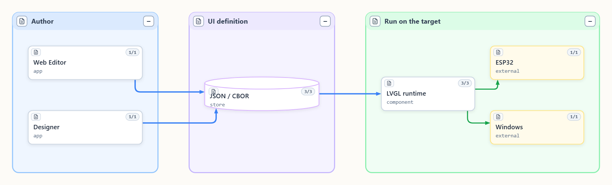
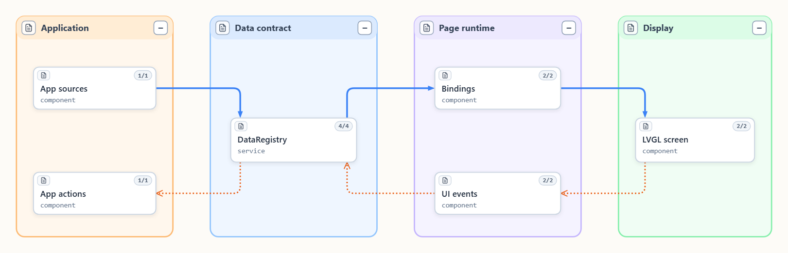
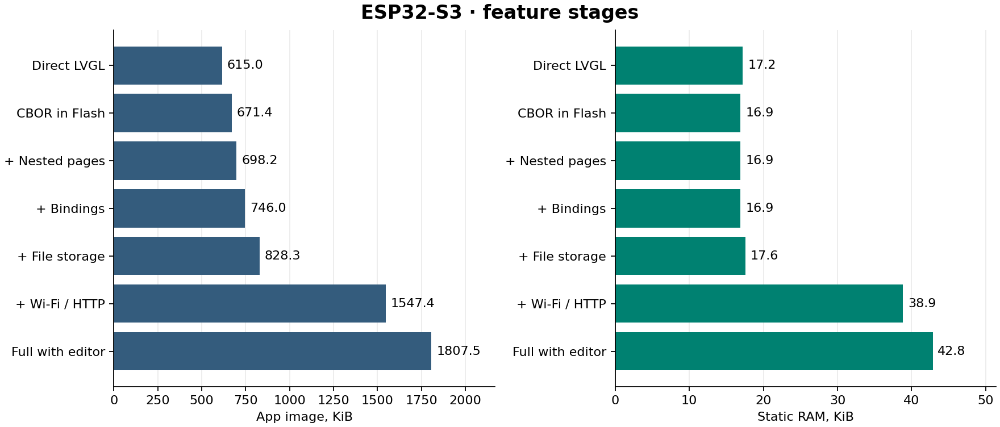

# NaCBORUIforLVGL

Documentation filenames use `name.md` for English and `name.ru.md` for Russian.

[Русский](Readme.ru.md) · [Documentation](docs/README.md) · [Examples](examples/) · [MIT](LICENSE)

**Create LVGL interfaces from scratch and update them after deployment,
by hand or with an AI agent.** Define screens, styles, data bindings and actions
in JSON. On the target, LVGL builds the interface from CBOR. The same application
can load different UI projects.



## Capabilities and selection

| Feature | What it provides |
| --- | --- |
| [Projects](docs/readme_projects.ru.md) | Screens, shared styles, an entry page, a base project and an optional changes store. Preview and save are separate. |
| [Nested pages](docs/readme_page_composition.ru.md) | Compose pages in containers with release, cache or retain policies. Each instance owns its bindings and events. |
| [Data and events](docs/readme_bindings.ru.md) | Typed values, structures and bounded arrays. Bindings update widgets. Events invoke registered actions or write to allowed sources. |
| [Themes and native widgets](docs/readme_native_components.ru.md) | Ordered style references, style parts/states, and application-registered LVGL components with discoverable metadata. |
| [Web editor](docs/readme_modules_files_css_mcp.ru.md) | Edit JSON/CBOR, styles and bindings in the browser. The layout tab approximates LVGL in CSS. The LVGL tab shows the real target frame. |
| [Windows/Android Designer](tools/designer/README.md) | Design with a model and the target's actual widget/data catalog. Direct API uses shared codecs inside the app. [MCP is optional](docs/readme_mcp.ru.md). |
| [Display transport](docs/readme_display_feedback.ru.md) | Native frames and optional remote pointer input. The 7″ S3 can send changed regions with LVF2 over HTTP or WebSocket. |

## Data and event paths



Application code owns the data sources, actions and resources. Bindings update widgets
on the LVGL task. The application executes actions after events are queued. The data
registry holds the latest values independently of which page is active, and can expose
bounded history.

The shared C++ runtime runs the project on Windows and ESP32. NaWServer carries HTTP/WS
traffic in the examples. The 7″ firmware accepts CBOR through Direct API. On Windows,
the player can expose a native MCP proof of concept, and Designer can expose its
connected Direct API session to external agents on loopback. See the [SeMaps
views](docs/readme_semaps.ru.md) and [MCP modes](docs/readme_mcp.ru.md).

## Memory and speed on hardware

7″ ESP32-S3, ESP-IDF 5.5.6, LVGL 9.6.0, 240 MHz. The paired 100-node scenes use `-Og`.

| Profile | Flash, KiB | Static RAM, KiB | First frame, ms |
| --- | ---: | ---: | ---: |
| Direct LVGL, repeated | 615.0 | 17.2 | 708.4 |
| CBOR, repeated | 671.4 | 16.9 | 776.7 |
| Direct LVGL, varied | 623.8 | 17.2 | 708.4 |
| CBOR, varied | 671.5 | 16.9 | 776.7 |
| Full benchmark with editor, HTTP/WS and LVF2 | 1807.5 | 42.8 | 2875.0 |



Two full-size 800 × 480 RGB565 framebuffers use **1,500 KiB of PSRAM**. The table
reports static internal RAM for the app.

In the original paired 100-node test, screen construction took **63–70 ms with direct
LVGL and 196–210 ms with CBOR** (about 3×). CBOR lets the same firmware load different
screen definitions. These times cover construction and activation before the first
render.

Named styles reuse the existing CBOR references. Embedded screens can opt into trusted
loading in the same build that checks editor uploads.

[S3 benchmark report and conclusions](examples/memory_bench/results-s3.md) · [CBOR validation modes](docs/readme_fast_executor.ru.md#проверка-входного-cbor) · [Number formatting measurements](examples/memory_bench/number-format-s3.md).

## Where it fits

Use it to create an interface for a device from scratch, build variants for
different users, or revise screens after deployment. For example, an agent can
build a dashboard from a description by choosing widgets, styling them, binding
sensor readings and assigning available actions to buttons. Adding a driver
or application feature requires an application build.

Display RAM depends on pixel format, render mode and buffer count. Large RGB
framebuffers can dominate PSRAM use. On the 7″ example, DIRECT and FULL use full-size
buffers. The LilyGO example demonstrates PARTIAL. See [display feedback and
limits](docs/readme_display_feedback.ru.md).

## Demos — explore and try

| Example | What to try |
| --- | --- |
| [Windows System](examples/windows_player/README.md) | Resize the window, switch schemes and view live CPU, RAM and available GPU counters. Run `npm run player`. |
| [Windows Graphics](docs/readme_graphics.ru.md) | Raster formats, GIF, SVG, curves, a shaped remote and an authoring canvas. Run `npm run player:graphics`. |
| [7″ ESP32-S3 RGB](examples/s3_style_lab/README.md) | Nested dashboard pages, simulated instruments, Setup and live HTTP/WS display. |
| [LilyGO T-Display-S3](examples/lilygo_t_display_s3/README.md) | Compact ST7789 UI, button input, USB diagnostics and optional Wi-Fi preview. |
| [Native widget](examples/native_widget/README.md) | Register a C++ widget and publish its authoring metadata. |

### Clean checkout and Windows player

The canonical [repository](https://github.com/NaBrIks/NaCBORUIforLVGL) and external
checkouts require access where private. Use Node.js `^20.19.0 || >=22.12.0`.

```powershell
gh repo clone NaBrIks/NaCBORUIforLVGL
cd NaCBORUIforLVGL
npm ci
npm test
npm run contract:check
npm run build
```

For the native player install Visual Studio C++ Build Tools, Windows SDK and CMake
3.24+. Use compatible NaWServer sources and pinned LVGL/TinyCBOR:

```powershell
git clone --depth 1 --branch v9.6.0 https://github.com/lvgl/lvgl.git local/deps/lvgl
git clone --depth 1 --branch v0.6.1 https://github.com/intel/tinycbor.git local/deps/tinycbor
git clone --depth 1 https://github.com/NaBrIks/NaWServer.git local/deps/NaWServer
./examples/windows_player/build.ps1 -LvglSource "$PWD/local/deps/lvgl" -TinyCborSource "$PWD/local/deps/tinycbor" -NaWServerSource "$PWD/local/deps/NaWServer"
npm run player
```

After building the player, `npm run sim` or `RunSimulator.cmd` rebuilds and serves the
editor. `npm run player -- interface.json --watch` reloads saved edits. The System and
Graphics profiles serve the editor on separate loopback ports. See the [Windows
guide](examples/windows_player/README.md) for ports, test commands and optional MCP, and
the [hardware setup](docs/readme_development_environment.ru.md) for ESP-IDF 5.5.6 and
board-specific configuration.

## Integrate and contribute

Start with the [C++ public headers](include/lvgl_cbor/README.md), [project
API](docs/readme_projects.ru.md) and [examples index](examples/README.md). Core sources
are in `src` and the shared codecs are in `packages`. The native HTTP adapters are in
`integrations/nawserver`. Designer is a separate application in `tools/designer` and
uses the external SPLA source dependency.

Project-owned code is MIT. Preserve the third-party notices for adapted board code, fonts, icons and external libraries. See [license scope](LICENSES.md) and [notices](THIRD_PARTY_NOTICES.md). C/C++ contributions use the [pinned Uncrustify configuration](agents/code_style.md).
