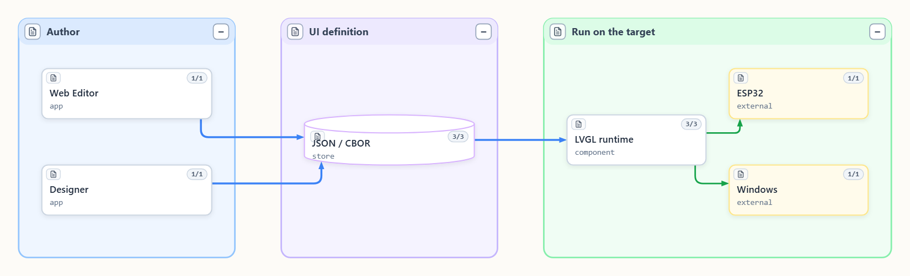
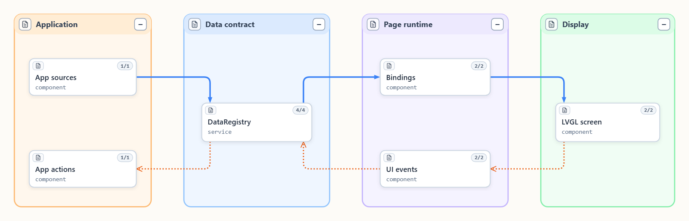
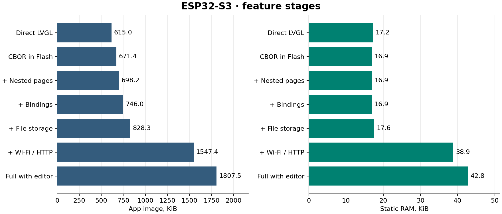

# NaCBORUIforLVGL

Английская документация использует имена `name.md`, русская — `name.ru.md`.

[English](Readme.md) · [Документация](docs/README.md) · [Примеры](examples/) · [MIT](LICENSE)

**Создавайте интерфейсы LVGL с нуля и обновляйте их после установки —
вручную или с помощью ИИ-агента.** Экраны, стили, привязки к данным и действия
описываются в JSON. На устройстве LVGL строит интерфейс из CBOR. Одно и то же
приложение может загружать разные проекты интерфейса.



## Возможности и выбор

| Возможность | Что даёт |
| --- | --- |
| [Проекты](docs/readme_projects.ru.md) | Экраны, общие стили, точка входа, базовый проект и необязательное хранилище изменений. Предпросмотр и сохранение разделены. |
| [Вложенные страницы](docs/readme_page_composition.ru.md) | Страницы в контейнерах с освобождением, кэшем или удержанием. У каждого экземпляра свои биндинги и события. |
| [Данные и события](docs/readme_bindings.ru.md) | Типизированные значения, структуры и ограниченные массивы. Биндинги обновляют виджеты, события вызывают действия или записывают в разрешённые источники. |
| [Схемы и нативные виджеты](docs/readme_native_components.ru.md) | Стек именованных стилей, части и состояния LVGL, регистрация компонентов приложения с каталогом возможностей. |
| [Веб-редактор](docs/readme_modules_files_css_mcp.ru.md) | Редактирование JSON/CBOR, стилей и биндингов в браузере. «Макет» использует CSS, «LVGL» показывает реальный кадр цели. |
| [Designer Windows/Android](tools/designer/README.md) | Авторинг через модель и каталог устройства. Прямой API использует общие кодеки внутри приложения. [MCP опционален](docs/readme_mcp.ru.md). |
| [Передача экрана](docs/readme_display_feedback.ru.md) | Нативные кадры и удалённый ввод. 7″ S3 передаёт изменившиеся области в LVF2 по HTTP или WebSocket. |

## Данные и события



Приложение владеет источниками, действиями и ресурсами. Биндинги обновляют виджеты в
задаче LVGL. События ставят вызовы действий в очередь приложения. Реестр хранит
последние значения независимо от открытой страницы и может публиковать ограниченную
историю.

Проект на Windows и ESP32 выполняет общее ядро C++. В примерах HTTP/WS обслуживает
NaWServer. Прошивка 7″ принимает CBOR через прямой API. Windows-проигрыватель может
включать встроенный MCP, а Windows Designer — отдавать инструменты текущего прямого
подключения внешним агентам на loopback. [Модель SeMaps](docs/readme_semaps.ru.md) ·
[Режимы MCP](docs/readme_mcp.ru.md)

## Память и скорость на плате

ESP32-S3 7″, ESP-IDF 5.5.6, LVGL 9.6.0, 240 МГц. Контрольные сцены по 100 узлов собраны
с `-Og`.

| Профиль | Flash, КиБ | Статическая RAM, КиБ | Первый кадр, мс |
| --- | ---: | ---: | ---: |
| Прямой LVGL, повторяющаяся | 615,0 | 17,2 | 708,4 |
| CBOR, повторяющаяся | 671,4 | 16,9 | 776,7 |
| Прямой LVGL, разнородная | 623,8 | 17,2 | 708,4 |
| CBOR, разнородная | 671,5 | 16,9 | 776,7 |
| Полный стенд с редактором, HTTP/WS и LVF2 | 1807,5 | 42,8 | 2875,0 |



Два полноэкранных буфера RGB565 800 × 480 требуют **1 500 КиБ PSRAM**. В таблице
показана статическая внутренняя RAM приложения.

В исходном парном тесте 100 узлов построение экрана заняло **63–70 мс прямым LVGL и
196–210 мс через CBOR** (примерно в 3 раза дольше). CBOR позволяет загружать разные
описания экранов в одной прошивке. Это время построения и активации до отрисовки.

Именованные стили используют существующие ссылки CBOR. Встроенный экран может
загружаться в доверенном режиме в той же сборке, которая проверяет загрузки из
редактора.

[Все 14 ступеней, измерения загрузки и оптимизации](examples/memory_bench/results-s3.ru.md#итоговый-прогон-после-оптимизаций) · [Режимы проверки CBOR](docs/readme_fast_executor.ru.md#проверка-входного-cbor) · [Замеры форматирования](examples/memory_bench/number-format-s3.md).

## Где подходит

Полезно, когда для одного устройства нужно собрать интерфейс с нуля,
подготовить разные варианты для пользователей или поменять экраны после установки.
Например, агент может по описанию собрать приборную панель: выбрать виджеты,
задать оформление, подключить показания датчиков и назначить кнопкам доступные
действия. Для нового драйвера или новой функции приложения нужна сборка.

Расход памяти дисплея зависит от формата, режима отрисовки и числа буферов. На 7″
примере DIRECT и FULL используют полноразмерные буферы. На LilyGO показан PARTIAL.
[Передача экрана и ограничения](docs/readme_display_feedback.ru.md)

## Демо — что запустить

| Пример | Что попробовать |
| --- | --- |
| [Windows System](examples/windows_player/README.md) | Изменить размер окна, сменить схему и посмотреть живые CPU, RAM и доступные GPU-метрики. Команда `npm run player`. |
| [Windows Graphics](docs/readme_graphics.ru.md) | Растровые форматы, GIF, SVG, кривые, фигурный пульт и холст. Команда `npm run player:graphics`. |
| [7″ ESP32-S3 RGB](examples/s3_style_lab/README.md) | Вложенные страницы приборов, симуляция данных, Setup и живой дисплей по HTTP/WS. |
| [LilyGO T-Display-S3](examples/lilygo_t_display_s3/README.md) | Компактный ST7789, кнопки, USB-диагностика и опциональный Wi-Fi-предпросмотр. |
| [Нативный компонент](examples/native_widget/README.md) | Регистрация C++-виджета и публикация метаданных для редактора. |

### Чистый checkout и Windows-проигрыватель

Для [репозитория](https://github.com/NaBrIks/NaCBORUIforLVGL) и приватных зависимостей
нужен разрешённый доступ. Версии Node.js `^20.19.0 || >=22.12.0`.

```powershell
gh repo clone NaBrIks/NaCBORUIforLVGL
cd NaCBORUIforLVGL
npm ci
npm test
npm run contract:check
npm run build
```

Для нативного проигрывателя нужны Visual Studio C++ Build Tools, Windows SDK и CMake
3.24+. Подготовьте совместимый NaWServer и закреплённые LVGL/TinyCBOR:

```powershell
git clone --depth 1 --branch v9.6.0 https://github.com/lvgl/lvgl.git local/deps/lvgl
git clone --depth 1 --branch v0.6.1 https://github.com/intel/tinycbor.git local/deps/tinycbor
git clone --depth 1 https://github.com/NaBrIks/NaWServer.git local/deps/NaWServer
./examples/windows_player/build.ps1 -LvglSource "$PWD/local/deps/lvgl" -TinyCborSource "$PWD/local/deps/tinycbor" -NaWServerSource "$PWD/local/deps/NaWServer"
npm run player
```

После сборки проигрывателя `npm run sim` или `RunSimulator.cmd` пересобирает и запускает
редактор. `npm run player -- interface.json --watch` подхватывает изменения файла.
System и Graphics раздают редактор на разных loopback-портах. [Руководство
Windows](examples/windows_player/README.md) содержит порты, тесты и параметры MCP.
Настройка ESP-IDF 5.5.6 и плат описана в [руководстве
среды](docs/readme_development_environment.ru.md).

## Интеграция и вклад

Начните с [публичных заголовков C++](include/lvgl_cbor/README.md), [API
проектов](docs/readme_projects.ru.md) и [каталога примеров](examples/README.md). Ядро
лежит в `src`, общие кодеки — в `packages`, нативные HTTP-адаптеры — в
`integrations/nawserver`. Designer — отдельное приложение в `tools/designer` с внешней
зависимостью от исходников SPLA.

Собственный код распространяется под MIT. Сохраняйте сторонние уведомления об адаптациях платы, шрифтах, иконках и библиотеках. [Область лицензии](LICENSES.md) · [Уведомления](THIRD_PARTY_NOTICES.md) · [Закреплённый Uncrustify для C/C++](agents/code_style.ru.md)
