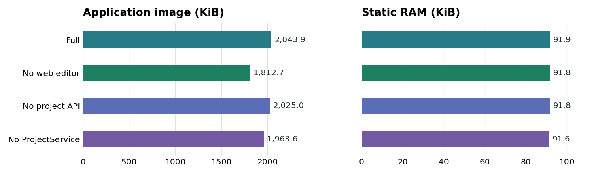

# Память, размер прошивки и отклик

Замеры 12.11.2026 для NaCBORUIforLVGL на базе `9b083a5` с исправленной сборкой профиля без ProjectService.
Основная матрица относится к Waveshare ESP32-S3 Touch LCD 7 (800 × 480),
ESP-IDF 5.5.6, LVGL 9.6.0, PlatformIO, Release. NaWServer и остальные
зависимости одинаковы во всех строках матрицы. Конфигурация ESP-IDF и
режим выделения памяти LVGL также одинаковы.

## Цена функций в сборке S3

| Профиль | Файл приложения, Б | Δ файла, Б | Flash ELF, Б | Статическая RAM, Б | Δ RAM, Б |
| --- | ---: | ---: | ---: | ---: | ---: |
| Полный | 2 092 960 | — | 2 092 557 | 94 156 | — |
| Без встроенного редактора | 1 856 192 | −236 768 | 1 855 785 | 93 996 | −160 |
| Без HTTP API проектов | 2 073 552 | −19 408 | 2 073 153 | 93 996 | −160 |
| Без ProjectService | 2 010 704 | −82 256 | 2 010 301 | 93 748 | −408 |

Отключение редактора убирает из приложения упакованные веб-ресурсы.
Отдельный редактор может обращаться к оставшимся API. При отключении
только HTTP API проектов сам ProjectService и хранение остаются в прошивке.
В последней строке из сборки исключены сервис, хранилища проектов
и HTTP API проектов. Декодер пакета CBOR нужен встроенным схемам.

Повторная сборка полного профиля дала 2 090 976 Б.
Разброс составил 1 984 Б (1,9 КиБ), при той же статической
RAM и секции `.flash.rodata`. Дельты в таблице рассчитаны от первой сборки.

| Секция ELF, Б | Полный | Без редактора | Без API проектов | Без ProjectService |
| --- | ---: | ---: | ---: | ---: |
| Код `.flash.text` | 1 416 986 | 1 414 598 | 1 399 294 | 1 344 730 |
| Константы `.flash.rodata` | 545 288 | 310 904 | 543 576 | 535 288 |
| Инициализированные данные `.dram0.data` | 22 476 | 22 476 | 22 476 | 22 476 |
| BSS `.dram0.bss` | 71 680 | 71 520 | 71 520 | 71 272 |

`firmware.bin` — размер файла приложения. Отдельные образы загрузчика,
таблицы разделов и SPIFFS в эту цифру не входят. Flash и RAM в отчёте
PlatformIO считаются по секциям ELF. Статическая RAM включает
инициализированные данные и BSS, которые учитывает PlatformIO. Размер
стека задач, heap, сетевые буферы и framebuffer измеряются отдельно.

В этой плате один слот приложения имеет 5 МиБ, весь Flash — 16 МиБ.
Образ SPIFFS занимает отдельный раздел в 4 МиБ. Это размер раздела,
а не сумма байтов экранов и стилей.

### Как воспроизвести

1. В одном checkout соберите веб-редактор (`npm ci`, `npm run build`),
   упакуйте его (`node tools/pack_assets.mjs`) и соберите базовый профиль
   (`./tools/build_s3.ps1`).
2. Выберите по одному `-WithoutEditor`, `-WithoutProjectApi`,
   `-WithoutProject`. Перед каждым сравнением проверьте, что
   игнорируемый `sdkconfig.<профиль>` повторяет `sdkconfig.s3`.
   Для чистого сравнения используйте один и тот же sdkconfig и флаги
   `LVGL_CBOR_EMBED_EDITOR=OFF`, `LVGL_CBOR_PROJECT_API=OFF`,
   `LVGL_CBOR_PROJECT_SERVICE=OFF` соответственно. Для отключения
   сервиса также выключите его HTTP API. Декодер CBOR-пакета остаётся
   доступен демке для встроенных цветовых схем.
3. Собирайте профили последовательно. ESP-IDF Component Manager в одной
   папке может обновлять `managed_components` при конфигурации другого
   профиля. Сверьте итоговые значения в sdkconfig, строки RAM/Flash
   и длину `.pio/build/<профиль>/firmware.bin`.
4. Для динамических измерений сравнивайте одну и ту же страницу,
   число клиентов, режим передачи и окно времени. Снимайте `/api/info`
   и `/api/display/config`. Одинаковый `boot_id` связывает выборку
   с одним запуском платы.

Пример несопоставимых сборок: один старый профиль включал встроенный
аллокатор LVGL с пулом 64 КиБ, а базовый использовал libc. Такая разница
меняет BSS и размещение памяти. Эти измерения исключены из матрицы.

## Рабочая RAM и PSRAM дисплея

Waveshare использует полноразмерные RGB565-буферы панели в PSRAM в обоих
режимах DIRECT и FULL. Один буфер — `800 × 480 × 2 = 768 000 Б`
(750 КиБ), два — 1 536 000 Б (1500 КиБ). Переход с двух на один
уменьшает **полезный объём framebuffer на 750 КиБ**. Дополнительные
резервы и выравнивание драйвера сюда не включены. DIRECT уменьшает
область перерисовки и передачи, а размер каждого буфера сохраняется.

Адаптивный RLE выделяет рабочую память под одну порцию — 4096 Б при успешном выделении.
Потоковый RLE и RAW обходятся без этого временного буфера.
Общая память TCP/WS и рабочие буферы панели остаются отдельными.
[Протокол кадров и режимы передачи](readme_display_feedback_ru.md)

### Замер на работающей 7″ плате

Активная конфигурация — DIRECT, два буфера, RGB565, Dirty, RLE с буфером.
В течение 9.36 с сделано 12 чтений `/api/info`.
Настройки и прошивка во время наблюдения не менялись.

| Метрика | Результат |
| --- | ---: |
| Свободная внутренняя 8-bit RAM | 66 295–66 415 Б |
| Свободная PSRAM | 4 490 648–4 501 912 Б |
| HTTP `/api/info`, минимум / медиана / максимум | 38.7 / 84.2 / 134.0 мс |
| Средняя загрузка двух ядер по времени Idle | 43.0% |
| Время задач `main` и `naw_tcp_http` от длительности окна | 73.9% / 5.6% одного ядра |

Это наблюдение в текущей конфигурации, включая сам опрос API.
Время задач рассчитано по разности счётчиков FreeRTOS. Загрузка двух
ядер — доля времени вне `IDLE0` и `IDLE1` относительно суммарного
времени двух ядер. Это не сравнение нагрузки разных профилей и
не время доставки кадра. Другие профили в этом прогоне на плату
не записывались. Динамическая память отключаемых функций не выводится
из статической RAM.

## Как меняется передача кадра

Отдельные аппаратные испытания 11.11.2026 сравнивали варианты на одной плате
и одинаковой странице. На Dashboard в DIRECT/2/Dirty адаптивный RLE
уменьшил обновление со 187,1 до 20,9 КиБ и с 1,09 до 0,39 с.
Время HTTP-задачи выросло с 4,65 до 6,23% одного ядра в окне обновления.
На другом тесте смена секунды в Designer при том же режиме дисплея
появлялась с медианой 615 мс по HTTP и 133 мс по WS. Это время до
отрисовки изменений с учётом частоты опроса, а не RTT сети.

В прежнем тесте кадров DIRECT/1 оставлял 5220 КиБ свободной PSRAM,
DIRECT/2 — 4471 КиБ. Разница 749 КиБ близка к расчётным 750 КиБ.
Визуальные особенности однобуферных режимов описаны в отчёте по порциям.

[RAW и RLE](reviews/REVIEW_20261111_display-rle.md) ·
[HTTP и WS](reviews/REVIEW_20261111_display-ws.md) ·
[Один и два буфера](reviews/REVIEW_20261111_display-packets.md)

## Компактный дисплей LilyGO

T-Display-S3 (320 × 170, RGB565, PARTIAL) выделяет два DMA-буфера
по 20 строк во внутренней RAM. Полезный объём — `320 × 20 × 2 × 2 = 25 600 Б`
(25 КиБ). Полноразмерного буфера для этого пути нет.

| Собранный профиль LilyGO | Файл приложения | Статическая RAM PlatformIO |
| --- | ---: | ---: |
| USB | 1 021 616 Б | 26 120 Б |
| USB + Wi-Fi/WS | 1 674 320 Б | 48 892 Б |

Это сравнение двух готовых профилей. Разница включает Wi-Fi и NaWServer
вместе с поддержкой WS и не является размером одного WebSocket-модуля.
[Сборка и ограничения LilyGO](../examples/lilygo_t_display_s3/README.md)
