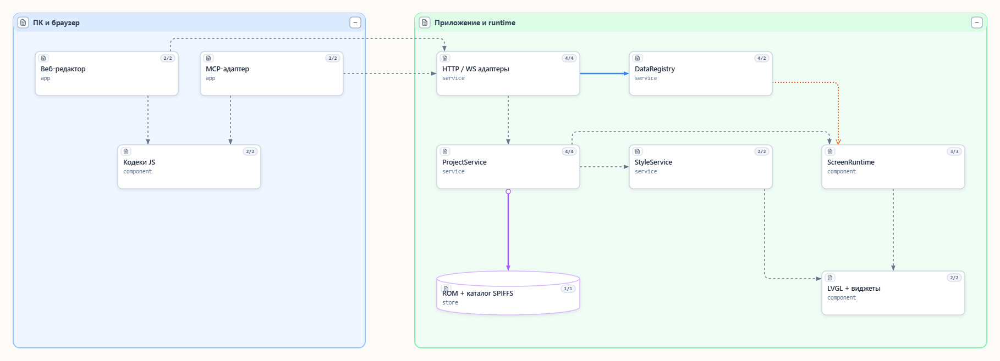
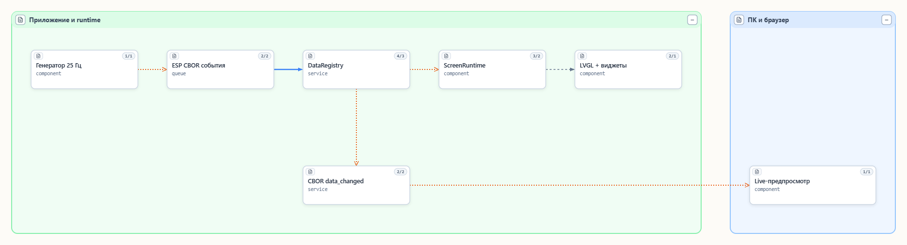

# SeMaps: архитектура и локальные MCP

Архитектурная документация SeMaps впервые добавлена 2026-10-28.
2026-10-29 в архитектурный вид добавлен Windows-проигрыватель: общие кодеки →
тот же ProjectService/runtime. Это отдельный Win32 target; сетевой адаптер МК
и аппаратные драйверы в него не входят. См. [руководство](readme_windows_player_ru.md).
Описание Windows-узла также отражает четыре цветовые схемы: общие кодеки,
StyleRuntime и статические ресурсы ui.*; смена палитры сохраняет экземпляры страниц.
2026-10-30 описания уточнены для T-Display-S3 и вынесенных в `examples/common`
Appearance/DemoData: платформенные адаптеры разные, C++-модули и ядро общие.
Композиция и геометрия карты при этом не менялись.
`nacboruiforlvgl.semaps` открывает workspace `docs/diagrams` относительно корня
этого checkout. Модель `nacborui` содержит два сохранённых вида:

| Вид | Что объясняет |
|---|---|
| `v_architecture` | Редактор/MCP, общие кодеки, HTTP/WS, ProjectService, хранение, runtime, данные и стили |
| `v_live_data` | Автономный генератор → CBOR event queue → DataRegistry → биндинги/LVGL и live WS |

Это авторская карта **реализованных логических обязанностей**, сверенная с кодом.
Она не выдаётся за автоматически извлечённый граф C++-символов. Extractor не
настроен; пустой граф не доказывает отсутствие вызовов или зависимостей.
В описаниях узлов указаны соответствующие исходники. Подробные контракты остаются
в руководствах [проектов](readme_projects_ru.md), [биндингов](readme_bindings_ru.md),
[композиции](readme_page_composition_ru.md) и [демособытий](readme_demo_events_ru.md).





## Запуск

Из корня репозитория при установленном `semaps` в PATH:

```powershell
semaps nacboruiforlvgl.semaps
semaps check nacboruiforlvgl.semaps
```

В проектном файле закреплён отдельный порт 42761, проверенный свободным перед
первым запуском. По умолчанию схемы доступны по
[архитектуре](http://127.0.0.1:42761/app/#v_architecture) и
[потоку данных](http://127.0.0.1:42761/app/#v_live_data).
Если порт занят на другом компьютере, фактический адрес смотрите в выводе SeMaps;
не останавливайте постороннюю службу. Порт 443 не использовать.

## Разные серверы MCP

| Имя | Команда | Назначение |
|---|---|---|
| `semaps` | `semaps mcp` | Авторская архитектурная модель и виды, не управление МК |
| `nacborui` | `node integrations/mcp/index.js` | Кодеки и необязательная работа с существующим API МК |
| `nacborui_windows` | Та же команда с отдельным окружением | Постоянный Windows API на loopback:5300; preview/save/data разрешены |

Перечисленные конфигурации используют stdio. Для MAUI-прототипа добавлен отдельный native NaWServer HTTP MCP gateway (порт примера 5302), который вызывает те же SDK-обработчики и существующий Windows API через закрытый канал процесса. См. [MAUI-конструктор](readme_maui_designer_ru.md).
В прошивке находятся HTTP/WS адаптеры; MCP SDK и отдельный `/mcp` listener
в неё не добавляются. SeMaps host HTTP нужен своему редактору, не LCD.

`.mcp.json` предназначен для клиентов, читающих такой формат. Codex использует
`.codex/config.toml` для доверенного проекта, а не автоматически любой
`.mcp.json`: [официальная документация OpenAI](https://learn.chatgpt.com/docs/extend/mcp?surface=cli).
Наличие файла не доказывает активное подключение. После загрузки настроек
перезапустите/переподключите MCP и проверьте фактический список инструментов.
Глобальные настройки, доверие и политики разрешений других серверов этот проект
не изменяет. Запускайте клиента из настоящего корня checkout.

У `nacborui` по умолчанию не задан `LVGL_CBOR_DEVICE`; preview/save/data разрешения
равны 0. Текущие четыре офлайн-инструмента: `get_ui_reference`, `get_example`,
`validate_document`, `convert_css`. Адрес устройства задаётся
приватно в окружении клиента; реальный LAN-адрес в Git не записывайте.
Группы разрешений описаны в [руководстве MCP](readme_mcp_ru.md).

## Обновление карты

1. Проверить `list_projects`: ожидается `nacborui`. Нельзя считать чужой workspace
   этим проектом только из-за одинакового имени сервера `semaps`.
2. Читать виды и описания через MCP; сравнить изменяемую ответственность с кодом.
3. Изменять registry/relations/text/placements только инструментами SeMaps;
   перед геометрией прочитать `layout_guide`. Не править JSON модели вручную.
4. После правок вызвать `render_view`, проверить границы, подписи и линии.
   Сохранение выполнять по поручению владельца. Затем `get_view`: `unsaved=[]`,
   и `semaps check`: код завершения 0.
5. При изменении архитектуры обновить эти текстовые ссылки и статические PNG
   экспортом из настоящего renderer. Host caches/journals остаются ignored.

Наличие карты не требует отдельного универсального skill: workflow и схемы
операций уже описывает установленный MCP. Новые навыки не добавлялись.

## Что проверено 2026-10-28

- Сначала обнаружен старый подключённый MCP с чужим workspace; в нём ничего
  не изменялось. Новый stdio-клиент из этого checkout подтвердил `nacborui`.
- Созданы и сохранены 16 логических узлов, 16 отношений, два вида. Во всех
  `get_view` после Save — `unsaved=[]`.
- `render_view` обоих видов: **no problems found**; изображения просмотрены.
  `semaps check`: замечаний нет. Ссылка зарегистрирована в локальном портале.
- Настоящий процесс UI MCP: офлайн `listTools` (4) и `get_ui_reference(kind=screen,topic=bindings-events)`
  — PASS. С адресом МК зарегистрированы 11 read-only инструментов; изменяющих
  операций нет. `get_device` не завершился из-за недоступного устройства;
  независимый прямой HTTP-запрос также получил timeout. Новая аппаратная приёмка
  этим не заявляется; предыдущие успешные проверки описаны отдельно.
- В текущем установленном Codex CLI `mcp get semaps` подтверждает stdio-команду;
  `mcp get nacborui` пока не обнаруживает проектный сервер. Новый конфиг подготовлен,
  его загрузку в новом доверенном сеансе ещё нужно подтвердить. Работа адаптера
  независимо подтверждена реальным stdio-клиентом выше.
- Конкретные пути компьютера, LAN-адреса и исходные журналы находятся только
  в ignored `local/`; настройки/исходники соседних проектов не менялись.

## Системные показатели Windows, 2026-10-30

Описание `e_windows_player` дополнено через SeMaps MCP: SystemMetrics владеет
потоком PDH/DXGI и ограниченной историей; UI-поток передаёт CBOR в общий
DataRegistry. `demo:history_plot` относится только к примеру и регистрируется
через существующий каталог. Связи и геометрия карты остаются прежними.
Сохранение подтверждено, `semaps check` не нашёл замечаний. Подробности —
[приёмка системного обзора](reviews/REVIEW_20261030_windows-system.md).

В тот же день описания `e_runtime`, `e_projects`, `e_windows_player` обновлены
через MCP для явного ScreenViewport и изменяемого окна. Модель сохранена,
`semaps check` без замечаний. Геометрия и связи не менялись. См.
[проверку resize](reviews/REVIEW_20261030_windows-resize.md).

## Реестр и выборочный MCP, 2026-11-07

Через SeMaps MCP обновлены ответственности `e_registry`, `e_mcp`, `e_windows_player`
и `e_http`: группы/метаданные, immutable DataView, bounded queries и необязательный
DataHistory. Модель сохранена, оба get_view подтвердили `unsaved=[]`, `semaps check`
не нашёл замечаний. Связи и геометрия не менялись. Новый render_view не выполнен:
сервер вернул `no editor is open`; прежние PNG не выдаются за свежий render.
Подробности — [принятое решение](adr/ADR_20261107_data-catalog-history.md).

В той же итерации через MCP дополнено описание Windows Appearance: авторские
roleOverrides, стек стилей и редизайн project.styles через MCP. Модель повторно
сохранена и проверена без изменения геометрии.

## Постоянный Windows API, 2026-11-07

Проектный nacborui_windows использует тот же MCP с LVGL_CBOR_DEVICE, направленным
на постоянный HTTP API проигрывателя. .codex/config.toml и .mcp.json содержат
отдельную запись. Настройка подтверждена `codex mcp get nacborui_windows`, настоящий
SDK-клиент подключился и выполнил preview/восстановление/действия через production
API. Изменения tool catalog открытого Codex-клиента требуют переподключения MCP;
сама запись файла не доказывает hot reload. [Официальная документация OpenAI](https://learn.chatgpt.com/docs/extend/mcp?surface=cli).
Подробности — [руководство Windows API](readme_windows_api_ru.md).

Описания e_windows_player/e_mcp/e_http обновлены через SeMaps MCP для постоянного
Windows HTTP transport и общего ProjectService/FileProjectStore. Модель сохранена,
оба вида без unsaved; semaps check без замечаний. Геометрия и PNG не менялись.


## Отладочные стили, 2026-11-09

Через MCP дополнено описание `e_runtime`: параметры композиции, независимые outline и 16×16 A1
тайлы с цифрами глубины, opacity и индивидуальными глубинами, отсутствие overlay и изменения JSON/CBOR. Модель сохранена,
`semaps check` без замечаний; связи, геометрия и PNG карты не менялись.
См. [реализацию и ограничения](readme_layout_debug_ru.md).

Уточнение интерфейса: два постоянных ряда, независимые цвета/флаги каждой глубины и толщина 3px; описание e_runtime обновляется через MCP, геометрия схем не меняется.

Уточнение 09.11: через MCP обновлены e_runtime/e_pc — штатный Designer перенесён
в tools/designer, добавлен per-depth выбор большой цифры или G/F. Оба get_view
подтвердили unsaved=[], semaps check без замечаний. Геометрия карты не менялась.

UI 09.11: схема e_pc/e_runtime дополнена таблицей глубин, общим G/F,
сохраняемым коротким splitter и EN/RU ресурсами. Исполнитель SPLA и API неизменны.

09.11: e_windows_player обновлён через MCP после удаления LLM-агента.
В демке только LVGL/data/API, viewer/editor и MCP; SPLA и инструкции — в Designer.
