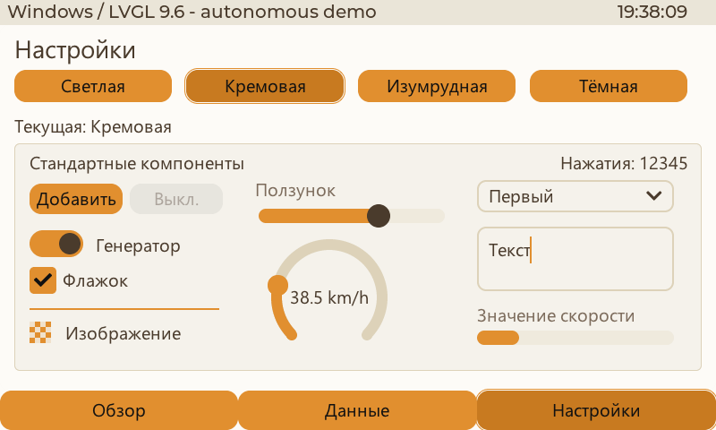
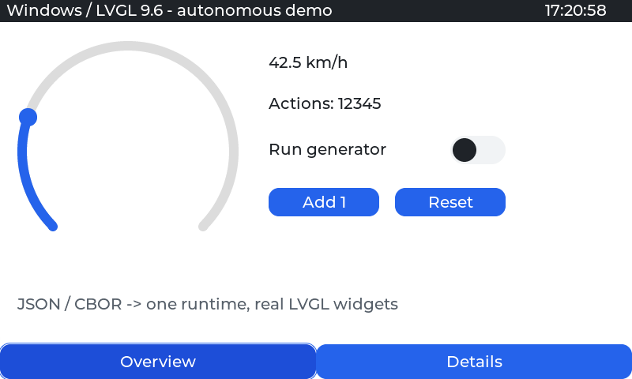
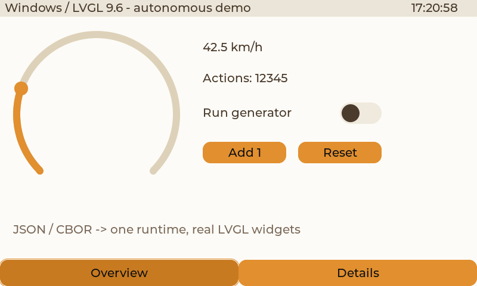
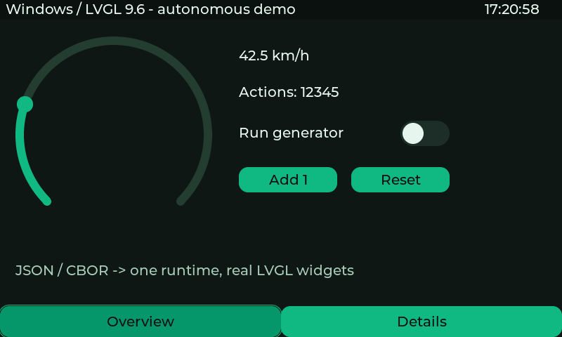
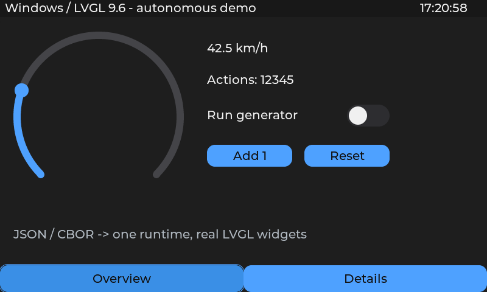

# Windows-проигрыватель на настоящем LVGL

Добавлен 2026-10-29 в `examples/windows_player`. Это отдельное приложение MIT:
родной Windows backend из LVGL 9.6.0, общие кодеки и существующее ядро C++.
S3 и её проект/файловая система при разработке этого приложения не используются.

С 2026-10-30 Appearance и DemoData находятся в `examples/common` и используются
также настоящей T-Display-S3. Windows владеет файловым адаптером, меню и Segoe UI;
на MCU те же общие модули получают ROM-CBOR и встроенные шрифты.
См. [аппаратную проверку 320×170](reviews/REVIEW_20261030_lilygo.md).

```text
Project JSON → document-io / project-codec → Project CBOR
Project CBOR → те же кодеки: проверка и каноническая компиляция
                        ↓
       существующий ProjectService → ScreenRuntime → LVGL Win32
                        ↑                     ↑
      данные приложения → DataRegistry → биндинги / события
```

JSON остаётся редактируемым исходником. На ПК он компилируется в памяти с
проверкой фактического каталога приложения. C++ исполняет CBOR тем же курсорным
исполнителем, что и на МК. Вторая модель дерева команд, JSON-движок, отдельная
реализация биндингов или событий не добавлены. Изменений ABI нет.

## Запуск

Нужны CMake 3.24+, Visual Studio C++ Build Tools с Windows SDK, Node.js и `npm ci`
в корне. Используются исходники LVGL 9.6.0 и TinyCBOR 0.6.1. Уже загруженные
managed dependencies демки можно переиспользовать как библиотеки исходников;
ESP-IDF, драйверы платы, NaWServer и сборка прошивки не нужны.

```powershell
npm ci
npm run player:build
npm run player
npm run player -- '<projects>/interface.json' --watch
npm run player -- '<projects>/interface.cbor'
```

Если зависимости хранятся отдельно:

```powershell
./examples/windows_player/build.ps1 -LvglSource '<deps>/lvgl' -TinyCborSource '<deps>/tinycbor'
```

Структура папок, источники зависимостей, запуск отдельной страницы и все
параметры описаны в [README примера](../examples/windows_player/README.md).
Результат сборки находится в ignored `local/windows-player`. Старый каталог
`local/windows-player-build` оставлен на месте: ранее запущенный проигрыватель
не требуется останавливать ради сборки новой версии.

## Системный обзор Windows

При обычном запуске демка открывает **«Система»**: CPU целиком и по логическим
процессорам, физическая память, GPU и его выделенная/общая память видны совместно.
Это реальные показатели компьютера. Четыре новых источника `system.cpu`,
`system.cores`, `system.memory`, `system.gpus` регистрируются приложением;
поля и графики получают данные обычными биндингами через CBOR.

Используются только API Windows SDK: PDH, DXGI и GlobalMemoryStatusEx. Новых
пакетов и SDK производителей нет. Фоновый поток раз в секунду заменяет один
ограниченный снимок; UI-поток публикует его в существующий DataRegistry.
История принадлежит источнику: 32 отсчёта сохраняются и пополняются вне страницы.
Выключение демонстрационного генератора скорости не останавливает мониторинг.

График — небольшой зарегистрированный компонент **`demo:history_plot`** самого
примера, метод `series` принимает `{label, history}`. Контракт находится рядом
с примером, передаётся обычным каталогом возможностей и использует штатный
диспетчер/биндинги. Ядро и редактор не содержат специальной логики мониторинга.
`-1` в истории — разрыв, а отсутствующий показатель отображается как `—`.
Четыре схемы меняют и текст, и линии без пересоздания страниц.

CPU измеряет `% Processor Time`; число может отличаться от Processor Utility в
диспетчере задач. Показаны логические процессоры, включая SMT. Для каждого GPU
суммируются процессы одного физического движка, затем выбирается самый занятый
движок. Выделенная память берётся для всего адаптера; общая память GPU уже входит
в RAM и повторно к ней не прибавляется. Доступность GPU зависит от WDDM-драйвера;
при отсутствии счётчика демка продолжает работать и не подставляет ноль.

Границы примера: 64 логических процессора, четыре аппаратных GPU, 32 отсчёта на
график. Общая загрузка CPU учитывает все процессоры; `count` / `displayed`
явно показывают ограничение списка. До 32 процессоров и двух GPU помещаются без
прокрутки, больше — прокрутка только своей области. Топология определяется при
запуске. Период около секунды, без претензии на точную трассировку времени.
Исходный `demo.json` содержит компоновку 32/2; только встроенная демка адаптируется
к фактическому каталогу перед общей компиляцией. Открытые пользовательские
JSON/CBOR-проекты остаются со своей разметкой.

Проверка: `npm run player:test-system` (около 35 секунд для настоящей истории).
Подробности — [отчёт приёмки](reviews/REVIEW_20261030_windows-system.md).

## Цветовые схемы

Страница **«Настройки»** доступна в нижнем меню после «Обзор», «Данные» и «Система».
На странице находятся четыре кнопки схем и
компактный пример всех **12 стандартных типов текущего runtime**: контейнер,
подпись, кнопка (обычная/недоступная), полоса, ползунок, дуга, линия, изображение,
флажок, переключатель, текстовое поле и выпадающий список. Всё помещается между
статусбаром и нижним меню без прокрутки. Отдельной реализации настроек в Win32 нет:
разметка находится в `demo.json` и исполняется тем же CBOR runtime.

Кнопки вызывают действие `ui.select_scheme`. Источник `ui.scheme` публикует
`{id, title}`; биндинги обновляют отметки выбора и строку текущей схемы.
Системное меню и control-команда используют тот же метод выбора. Переключатель
и кнопка мини-примера работают через существующие `demo.running` / `demo.step`,
а значение и полоса привязаны к `demo.speed`.

Для русских подписей добавлены ресурсы `ui_14` / `ui_20` / `ui_28`: встроенный в LVGL
TinyTTF читает установленный Segoe UI Windows. Файл шрифта не копируется в Git
и не распространяется с приложением. Ресурсы Montserrat сохранены. Цветовые
переходы стандартной темы в desktop-профиле отключены, чтобы при выборе палитры
не оставались временные цвета предыдущего состояния.



[Проверка страницы](reviews/REVIEW_20261029_windows-settings.md).
[Разбор идеи и ограничений схем](reviews/REVIEW_20261029_appearance-design.md).

В меню самого приложения **«Оформление: Кремовая» → «Цветовая схема»** доступны
**Светлая, Кремовая, Изумрудная, Тёмная**. Текущая отмечена; по умолчанию — кремовая.
Это первая проверка цветовых схем под Windows. Плотность, радиусы и компоновка
страниц этим переключателем не меняются. Windows-рамка и системное меню используют
оформление ОС; схема применяется к содержимому LVGL.

Основные цвета взяты из токенов UI.TechnicalShell и записаны как данные в
`examples/windows_player/schemes.json`. Скопированного CSS или кода оболочки нет.
Текст кнопки выбирается контрастным к обычному и нажатому фону. Проверка порога
4.5:1 включена в тесты; размер шрифта при переключении не меняется.

Схемы компилируются через обычные project/style-кодеки в CBOR-каталог ресурсов.
`Appearance` готовит варианты существующим `StyleRuntime`. Приложение передаёт
именованные `const lv_style_t *` в обычный список ресурсов `ProjectService`:
`ui.canvas`, `ui.panel`, `ui.status`, `ui.text`, `ui.muted`, `ui.button`,
`ui.button_pressed`, `ui.button_focus`, `ui.focus_outline`, `ui.button_disabled`, `ui.indicator`,
`ui.track`, `ui.knob`, `ui.arc_track`, `ui.arc_value`.

Страницы подключают их штатными ссылками `global-static:ui.*`, указывая часть и
состояние LVGL. Встроенная демка уже использует эти ссылки. Замена значений через
`StyleValue::replace` сохраняет адреса стилей; UI-контекст не допускает отрисовку
половины палитры. Страницы, кэш, текущая вкладка, события и данные сохраняются.
Ядро и ABI для этого не менялись; на S3 схема не внедрялась.

Для ON-переключателя явно подключён `ui.indicator` к `INDICATOR/CHECKED`:
иначе более конкретный синий стиль стандартной темы LVGL перекрывает DEFAULT.
В состоянии OFF сохранена прозрачность индикатора. Кнопки отдельно используют
FOCUS_KEY, дуги — FOCUS_KEY/EDITED, чтобы не оставлять чужую обводку при
клавиатурном фокусе. Теми же ролями оформлены
флажок, бегунок, курсор/выделение текста, линия и перекраска изображения.
Выпадающее окно списка LVGL создаёт отдельно от дерева страницы; небольшое
расширение темы приложения подключает к нему те же ресурсы и шрифт кириллицы.
Используются штатные обработчики LVGL, отдельного виджета в ядре не появилось.

Чужой проект должен явно использовать эти роли. Локальные свойства продолжают
перекрывать общий стиль, `copy/merge` продолжают создавать снимок, а рисуемые
вручную цвета нативных компонентов требуют отдельной адаптации. Автоматической
замены похожих RGB-значений нет.

Выбор сохраняется отдельно от проекта в `%LOCALAPPDATA%/NaCBORUIforLVGL/player.json`.
`--scheme dark` задаёт начальную схему; `--settings PATH` меняет файл настройки,
`--no-settings` отключает сохранение. В control-режиме работает
`{"op":"scheme","scheme":"emerald"}` — тот же механизм, который вызывает меню.

Ниже — снимки самого LVGL 800×480 из скрытого процесса, а не CSS-макет:

| Светлая | Кремовая |
| --- | --- |
|  |  |

| Изумрудная | Тёмная |
| --- | --- |
|  |  |

[Проверка схем](reviews/REVIEW_20261029_windows-schemes.md).

## Открытие и обновление

- `File → Open` / Ctrl+O: открыть целый JSON/CBOR-проект; F5: перечитать.
- `--watch`: уведомления файловой системы, короткая задержка для объединения
  сохранений; поддерживается атомарная замена файла редактором.
- Размер окна берётся из `size` стартовой страницы. DPI Windows масштабирует
  изображение, сохраняя логические размеры LVGL.
- При новом разрешении сначала готовится новое окно. Его приложение получает
  новые демоданные. При том же размере перезагружается композиция, а реестр
  приложения продолжает жить; кэш страниц сбрасывается обычным механизмом.
- Повреждённый файл или отказ загрузки корня оставляет предыдущий экран.
  Отказ дочерней страницы показывает штатную заглушку runtime с красным крестом.
- Ошибка обозначается в существующем заголовке окна. Подробности открываются
  через `Help → Details`; автоматически возникающих плашек и диалогов нет.
- Исходные файлы проекта не изменяются; автоматически сохранять их приложение
  не пытается. Временные CBOR-файлы удаляются после загрузки/завершения.

## Данные, биндинги и события

Источники и действия принадлежат Windows-приложению и регистрируются в обычном
`DataRegistry`. В примере есть `demo.speed`, `demo.running`, `demo.clicks`,
`system.clock` и действия `demo.step` / `demo.reset`. Для интерактивного примера
добавлены writable-источники `demo.level` (0..100), `demo.checked` (bool),
`demo.choice` (0..2), `demo.text` (UTF-8 до 128 байт; поле до 32 символов).
Все записи проходят тот же `DataRegistry`, без второго хранилища состояний.
Часы используют время
Windows; настройки NTP не меняются. Скорость публикуется автономно через
`publish_cbor` 25 раз в секунду. Страницы связывают значения с обычной дугой и
подписями; события кнопок вызывают зарегистрированные действия, переключатель
записывает writable-источник. Переходы и политики удержания/кэша выполняет
существующая композиция страниц.

`--control` — необязательный локальный адаптер для внешних данных и проверок:
JSON-lines stdin/stdout, внутри длина + CBOR. Команды `publish`, `write`, `invoke`
передают работу реестру. Это не новый сетевой сервер. Команда ограничена 64 KiB,
очередь — 32, проект — 2 MiB. Тестовый `click` отправляет LVGL event, а `inspect`
читает состояние/геометрию. Команда `event` отправляет `pressed`, `released`,
`focus` или `key` прямо обработчикам LVGL внутри процесса, без ввода в ОС.
Подробности и примеры — в README.

Нативные компоненты S3 автоматически не появляются на ПК: приложение должно
зарегистрировать их переносимую реализацию и метаданные через `WidgetRegistry`.
Неподдерживаемые возможности не заменяются похожим рисунком.

## Отличие от браузерного предпросмотра

`VirtualScreen.vue` продолжает приблизительно представлять экран через CSS.
Windows-проигрыватель выполняет настоящий LVGL и поэтому подходит для проверки
его геометрии, состояний, стилей, биндингов и событий без перепрошивки МК.
Память, FPS и аппаратные драйверы МК этим не проверяются.

Редактор пока не подключается к Windows-приложению через HTTP/WS. Рабочий путь:
экспортировать проект JSON/CBOR и открыть его в проигрывателе; для внешнего
редактирования файла включить `--watch`. В поставку пока не включён отдельный
Node runtime: для JSON нужен штатный launcher и установленный Node.js.

`npm run player:test` использует только **скрытые** Win32-окна. Проверка не
активирует их и не отправляет мышь/клавиатуру; состояние меню и цвета читаются
в самом процессе. Команда `snapshot` с `path` сохраняет BMP через `lv_snapshot_take`.
Снимки теста находятся в ignored `local/windows-schemes`. Для других запусков
автоматизации есть `--hidden`.

Проверены четыре палитры, ON/OFF переключателя и флажка, запись ползунка,
ввод/удаление текста, выбор пункта списка, курсор и отдельное всплывающее окно.
Снимки `settings-<scheme>-on.bmp` и `settings-<scheme>-popup.bmp` фиксируют эти
состояния. Проверка охватывает 12 типов нашего контракта, не весь каталог LVGL.

Проверки и их границы: [первый проигрыватель](reviews/REVIEW_20261029_windows-player.md),
[четыре схемы](reviews/REVIEW_20261029_windows-schemes.md).
