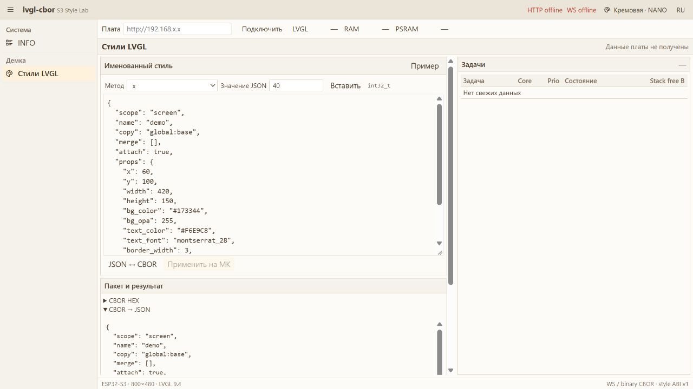

# Проверки первой реализации стилей

Дата: 2026-10-21. Каталог: `../lvgl-cbor`. Физическая плата не прошивалась. Это проверка конкретной заготовки, не сравнение XML и CBOR по ресурсам.

## Подтверждено

| Проверка | Результат |
|---|---|
| `npm test` | 135 тестов, 0 ошибок: roundtrip всех 128 методов, типы, диапазоны, маски, пересечения setter-ов, дубликаты/обрезание CBOR |
| Нативная сборка MSVC Release, x64 | Собран исполнитель с настоящими LVGL 9.4.0 и TinyCBOR из managed_components |
| Нативный интеграционный запуск | Применены x, size, RGB, именованный font; copy→merge, полная замена, uint32 max; изменение источника не меняет снимок |
| Отказ без замены текущего стиля | Проверены обрезанный CBOR, неверная сигнатура, пересекающиеся свойства, выход из диапазона, отсутствующий источник и отсутствующий ресурс |
| HTML-матрица | Колонка «Парам.» между № сигн. и C-сигнатурой присутствует для всех 71 групп; nowrap сигнатуры сохранён; проверка структуры исходного HTML |
| Вебка production | Vite 7.1.12: сборка успешна, assets упакованы в gzip для прошивки |
| Браузер 1280×720 | INFO и редактор; JSON↔CBOR; ошибочный int-аргумент; Cream/Nano и Dark/Nano; фиксированная оболочка и постоянная таблица задач |
| Реальный URL dev-редактора | `http://127.0.0.1:5298/` |
| ESP32-S3 | PlatformIO espressif32 6.10.0, ESP-IDF 5.4.0, LVGL 9.4.0, espressif/cbor 0.6.1~4: прошивка собрана |
| Статические размеры полной прошивки | PlatformIO: RAM 138 656 байт, Flash 882 120 байт; файл firmware.bin 882 528 байт. Это вся демка с Wi-Fi/HTTP/WS/LVGL и assets, не размер одного исполнителя |

Контракт: SHA256 `2f573a0410e7058c18ccf7452dcfcb063fb98ecfdf76571c4d7fafe3450a0dd5`. 128 shared-методов, 26 сигнатур. Количество в HTML включает получателя style/obj и selector; количество в таблице wire-аргументов не включает получателя.

Локальные логи: `local/js-tests.log`, `local/native-configure.log`, `local/native-build.log`, `local/web-build.log`, `local/firmware-final.log`. Они воспроизводимые и игнорируются. Команды воспроизведения — в README примера.

## Ограничения доказательств

На плате не проверены включение дисплея, синхронизация RGB, PSRAM, Wi-Fi, бинарный WS, реальные task/heap-показатели и видимые изменения LCD. Вебка при отсутствии платы показывает пропуски; строки задач и числовые показатели не подменялись фиктивными. Разные длины и значения настоящих строк задач требуют аппаратной проверки. HTTP↔WS связка проверена сборкой, а не живым обменом с устройством.

Не измерены пиковый heap, runtime Flash/RAM только ядра, скорость декодирования и отличие от XML. Статические размеры полной прошивки нельзя считать стоимостью TinyCBOR или исполнителя. Два RGB565 framebuffer по 800×480 требуют динамической памяти PSRAM; их нет в оценке статической RAM PlatformIO.

Методы с указателями проверены в примере на ресурсе шрифта. Все 128 метода имеют JS roundtrip и C++-обёртку, но не каждый из них имеет подходящий ресурс и видимый эффект на одном label. Деревья экранов, события/биндинги, произвольный selector, множество прикреплённых стилей и удаление отдельных записей пока не реализованы.

