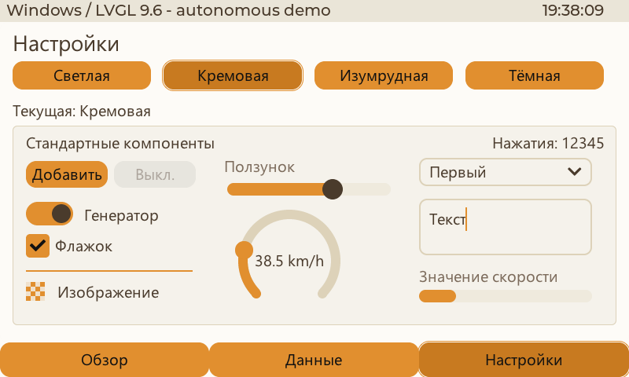
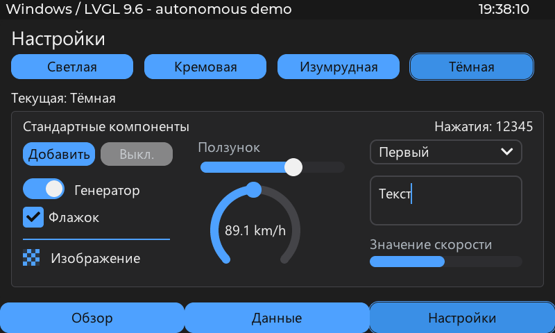

# Страница настроек Windows — 2026-10-29

Добавлена обычная CBOR-страница `settings` в демопроект Windows-проигрывателя.
Она вставляется в существующий контейнер между статусбаром и нижними кнопками.
Демка открывает её первой для проверки владельцем. Общий runtime и ABI не менялись.

Четыре кнопки выбирают схемы через зарегистрированное действие `ui.select_scheme`.
Источник `ui.scheme` содержит ID и название; обычные биндинги обновляют CHECKED
и подпись. Нативное меню использует тот же метод. Пример включает все 12
стандартных типов контракта: obj, label, button, bar, slider, arc, line, image,
checkbox, switch, textarea, dropdown; значения/действия связаны с текущими
демоисточниками и не реализованы отдельным механизмом.

После проверки владельцем обнаружен пропуск прежней приёмки: тест проверял
выключенный switch, но не его включённое состояние. Более конкретный стиль
стандартной темы на INDICATOR/CHECKED оставлял ON синим. Добавлена явная ссылка
на ui.indicator для CHECKED, прозрачность OFF сохранена. Общие роли также
покрывают флажок, бегунок, курсор/выделение текста, линию и sample image.
Стандартный dropdown создаёт отдельное popup-окно; приложение подключает к
нему те же shared-стили и шрифт через штатное расширение темы LVGL.

Русские подписи отрисованы LVGL TinyTTF через установленный Windows Segoe UI.
Проверяется наличие кириллического glyph без placeholder. Файлы шрифтов не
переносятся в репозиторий. В desktop-профиле отключены цветовые переходы
стандартной темы; выбранные кнопки и нижняя навигация используют явный CHECKED
стиль из текущей палитры.

Проверки:

- MSVC Release: сборка успешна; отдельный staging-каталог сохраняет работающее
  приложение до готовности новой версии.
- 307 JS-тестов — PASS; contract:check — PASS, ABI без изменений.
- Скрытый Win32 LVGL: все четыре кнопки страницы меняют текущую схему,
  выбранное состояние, подпись, меню и цвета без пересоздания экземпляра.
- Проверены кнопка мини-примера, данные 42.5 km/h, значение bar 43,
  cache/retain, возврат и сохранение выбора при рестарте.
- Во всех четырёх схемах проверены ON/OFF переключателя и флажка, цвет
  индикатора/бегунка, запись slider 65→66, ввод/удаление символа в textarea,
  цвет курсора, открытие dropdown и запись выбора 0→1. Проверяются фактические
  значения источников реестра после событий, а не только внешний вид.
- Дополнительная проверка воспроизвела обводку стандартной темы при FOCUS_KEY
  у кнопок. Добавлены явные ссылки для кнопок и дуг. Сочетания фокуса,
  редактирования, выбора и disabled проверены через обычные common-команды
  временного проекта, без ввода в ОС.
- Длинный счётчик, скорость 180.0 km/h и 32 кириллических символа проверены
  отдельно. Bounds полей неизменны; многоточие счётчика явно обозначает
  сокращение, полное значение источника сохраняется. Textarea прокручивает
  длинный текст внутри своей области, внешняя страница не прокручивается.
- Проверены цвет нажатой кнопки, линии/изображения и фон popup, включая смену
  схемы у уже открытого списка без пересоздания его страницы. Popup помещается
  выше нижнего меню. Экспортированы отдельные
  ON- и popup-снимки настоящего LVGL; кремовый ON и другие палитры просмотрены.
- Фактические координаты всех описанных компонентов проверены относительно
  их родителей. Прокрутка страницы отключена; изображения просмотрены целиком.
- Штатный немодифицированный демопроект отдельно стартует сразу с Settings
  и корректным первым значением источника ui.scheme.
- Мышь/клавиатура не отправляются; тест проверяет скрытое окно и отсутствие
  его активации. S3 не опрашивалась и не прошивалась.
- Испытанный Release EXE установлен в рабочий каталог проигрывателя; SHA256
  staging/рабочего файла совпадает. Приложение перезапущено без активации окна,
  штатный демопроект успешно загружен с кремовой схемой.
- Описание Windows-узла SeMaps обновлено через MCP и сохранено, unsaved=[];
  semaps check — замечаний нет. Геометрия карты не менялась. Новый render_view
  недоступен без открытого редактора SeMaps; рабочий стол для этого не переключался.
- Общие C++/LVGL/TinyCBOR-проверки tools/test_native.ps1 и сборка веб-редактора
  прошли. Ограничения и теоретический разбор: [схемы оформления](REVIEW_20261029_appearance-design.md).

Снимки кремовой и тёмной схем с включённым переключателем:

