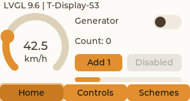
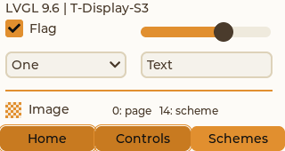
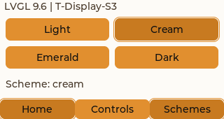

# T-Display-S3: прошивка и аппаратная проверка — 2026-10-30

Проверена настоящая LilyGO T-Display-S3 с цветным ST7789: ESP32-S3, flash 16 МБ,
PSRAM 8 МБ, горизонтальная область 320×170. Модель подтверждена владельцем,
чип и MAC сверены непосредственно перед записью. По разрешению владельца
выполнено полное стирание, затем записаны bootloader, таблица разделов и
приложение. Хэши всех трёх записанных образов проверены esptool.
Другие платы и настройки NTP не менялись.

## Реализация

Новый независимый MIT-пример находится в
`examples/lilygo_t_display_s3`. Параметры ST7789 и распиновка взяты из
[официального MIT-примера LilyGO](https://github.com/Xinyuan-LilyGO/LilyGo-Display-IDF/blob/master/main/display_s3.c);
уведомление сохранено в `NOTICE`. Адаптированный GPL-драйвер большого RGB-дисплея
и веб-оболочка в этот target не включены.

Повторной реализации движка нет. Используются существующие ProjectService,
ScreenRuntime, StyleService, DataRegistry и диспетчеры LVGL 9.6.0. Схемы
Appearance и генератор DemoData вынесены в `examples/common` и собираются
одними и теми же исходниками в Windows и MCU. Windows-адаптер лишь читает файл
в owned ProjectBytes; MCU использует ROM-span. Подготовка стилей и их смена
остались общими. Шрифты и отступы popup задаются платформой отдельно от цветов.

JSON-проект и каталог палитр компилируются существующими PC-кодеками в CBOR.
Размер проекта — около 10 КБ, каталога четырёх схем — около 9 КБ.
Приложение загружает их из ROM. JSON-парсер в прошивку не добавлен.
Пользовательский выбор схемы на MCU хранится в RAM; при старте открываются
Home / Cream. Windows сохраняет свой выбор отдельным прежним механизмом.

## Компоновка и управление

Макет создан под 320×170, без уменьшения Windows-картинки 800×480:

- статусная строка — 18 пикселей;
- общий контейнер дочерней страницы — 320×124;
- нижние кнопки на всю ширину — 28 пикселей.

Home («Обзор») показывает скорость, дугу, генератор, счётчик, кнопки и bar.
Controls («Компоненты») содержит checkbox, slider, dropdown, textarea, line
и image. Schemes («Схемы») выбирает Light / Cream / Emerald / Dark
(Светлая / Кремовая / Изумрудная / Тёмная). Всего представлены все 12 типов
текущего контракта. Состояние выбранной навигационной кнопки ведёт существующий
исполнитель композиции; дополнительная модель навигации не добавлялась.

GPIO0 переключает страницы, GPIO14 — схемы. Touch не предполагается.
Для компактной демки использованы встроенные Montserrat и английские подписи;
Segoe UI из Windows не копируется в прошивку. Метаданные и значения реестра
сохраняют UTF-8, в том числе русские названия схем.

## Проверки на устройстве

Транспорт приёмки — USB Serial/JTAG. Вход: длина LE32 и CBOR, до 4096 байт;
приёмный буфер фиксирован на 4100 байт. Команды выполняются в LVGL-задаче и
делегируют работу существующим сервисам. Диагностические ответы JSON отделены
маркером `@ui`. Это локальный тестовый адаптер, не новый HTTP/MCP-сервер.
Сеть, Bluetooth и NTP приложение не запускает.

`examples/lilygo_t_display_s3/tools/hardware.mjs` на настоящей плате — PASS:

- автономная публикация CBOR-скорости, рост sequence и реальных LCD-передач;
- 42.5 в подписи и округлённые 43 в дуге, событие кнопки и счётчик;
- все четыре палитры, нейтральный OFF и тематический ON переключателя;
- обратная запись checkbox, slider, ввод/удаление текста, выбор dropdown;
- фактические bounds всех компонентов относительно родителей на трёх страницах;
- кнопки выбора схемы и сохранение предыдущей схемы при ошибочном ID;
- удержанный экземпляр Home и продолжение источника при скрытой странице;
- все источники known, bindingErrors = 0.

Отрицательный тест неизвестной схемы намеренно увеличивает rejectedEvents;
это ожидаемый отказ действия, не ошибка биндинга. Во время приёмки найден и
исправлен дефект Python-переходника: его JSON-stdout зависел от кодовой страницы
Windows. Теперь ответ ASCII-safe, а тест проверяет точное русское название
каждой схемы после полного прохода CBOR → MCU → USB → host.

Камера подтверждает реальный вывод, ориентацию, цвет включённого switch,
читаемые подписи и изменяющуюся скорость. Владелец также подтвердил реальный
вид устройства. Экспозиция/фокус после каждого снимка восстанавливаются.
Оригиналы фотографий и журналы с идентификаторами устройства остаются ignored.

После отрицательных тестов плата отдельно перезапущена без повторной записи.
При контрольных чтениях sequence вырос с 7 до 1689, счётчик LCD-передач —
с 18 до 4100; все 9 источников known. После старта bindingErrors,
queueDropped и rejectedEvents равны 0, lastError пуст. Плата оставлена на
Home / Cream с работающим автономным генератором.

## Проверки на ПК

После выделения общих модулей успешно собран MSVC Release Windows target.
`test-window.mjs` — PASS: прежние 12 типов, четыре схемы, состояния, события,
reload, кэш, сохранение настроек и завершение без активации окна.
`test-preview.mjs` — PASS: тот же компактный JSON/CBOR-проект, три страницы ×
четыре схемы, реальные координаты и снимки настоящего LVGL в скрытых окнах.
Мышь/клавиатура ОС не отправлялись.
Полный набор JS — 308 тестов PASS; contract:check — PASS, ABI не менялся.
Повторно пройдены все группы `tools/test_native.ps1`, включая стили,
данные/события, биндинги, проектное хранение и жизненный цикл композиции.
Рабочий Windows-проигрыватель обновлён испытанным EXE, хэши staging/установленного
файла совпадают; приложение запущено без активации с сохранённой пользовательской
схемой. Описания SeMaps обновлены через MCP и сохранены, unsaved=[];
`semaps check` — замечаний нет.

Следующие иллюстрации — снимки Windows LVGL с тем же компактным проектом,
не фотографии платы:

Команды сборки и воспроизводимой приёмки:
[README примера](../../examples/lilygo_t_display_s3/README.md).
Теоретические границы и вопросы дальнейшего развития:
[разбор схем](REVIEW_20261029_appearance-design.md).
