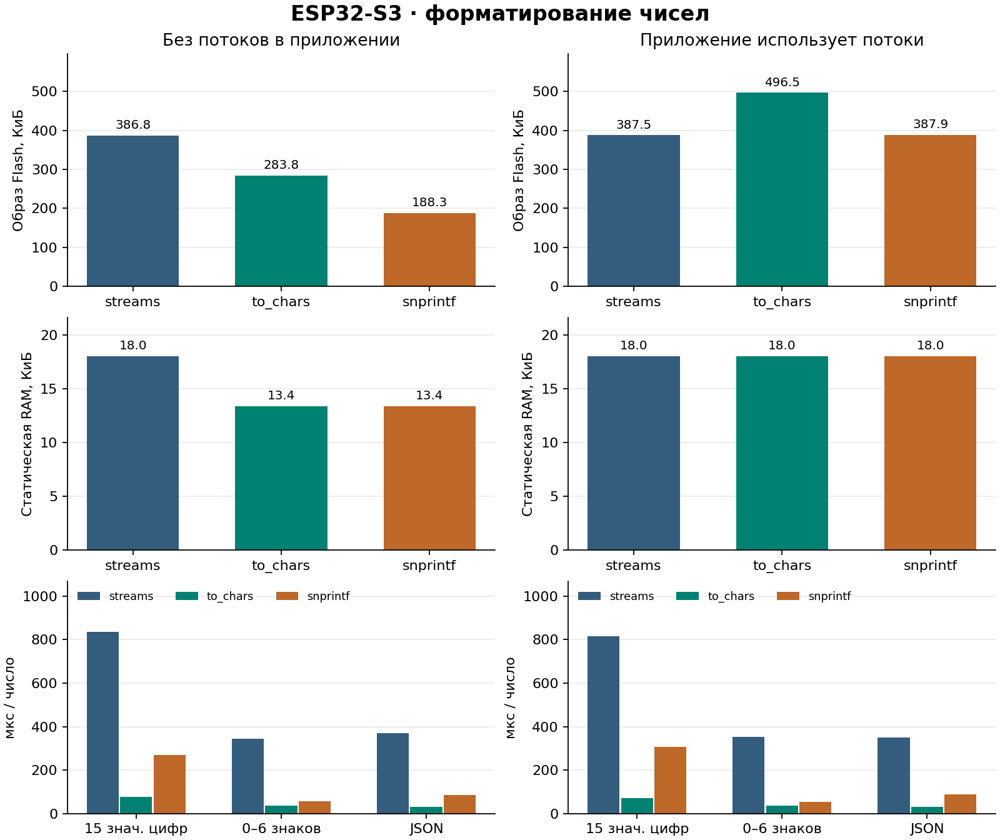

# Форматирование чисел на ESP32-S3

## Как измеряли

ESP-IDF 5.5.6, GCC 14.2, Newlib, CPU 240 МГц. Шесть образов с одинаковым
`sdkconfig`. Три реализации форматирования собраны отдельно, каждая с
прикладным логгером на `std::ostringstream` и без него. Логгер один раз
записывает дробное число до начала замеров, чтобы линкер включил
реально используемый путь потоков. Измерительный образ запускается
без панели, сети и PSRAM. Так видна цена форматирования в памяти, доступной
на минимальных МК. Полный профиль с панелью сравнивается отдельно по образам
и статической RAM.

Каждый образ выполняет пять серий по 2 048 чисел для каждого пути:

- Числовая часть биндинга без `precision`, до 15 значащих цифр.
- Та же часть биндинга с `precision` от 0 до 6, включая конечные нули.
- Реальный вызов `data_value_json()` для `double`, до 17 значащих цифр.

В наборах есть отрицательный ноль, случаи округления на половинах, границы
экспоненциальной записи и диапазона фиксированного формата, субнормальные
числа и обычные показания датчиков. JSON также проверяет NaN и бесконечности.
Время снимает `esp_timer_get_time()` по блокам по 64 числа. Между блоками
задача уступает процессор FreeRTOS. Эти паузы исключены из времени.
В измерение входят генерация входа, преобразование и контрольная сумма
выхода. Это время операции форматирования в составе теста, а не частота
отрисовки экрана. Для сводки используется медиана серий 2–5.
Flash — размер файла приложения. Статическая RAM — результат PlatformIO.
Пик heap считается относительно начала серии и включает первый вызов.

## Результаты

| Потоки в приложении | Форматтер | Flash, Б | Статическая RAM, Б | Биндинг, мкс | Биндинг с `precision`, мкс | JSON, мкс |
| --- | --- | ---: | ---: | ---: | ---: | ---: |
| Нет | Потоки | 396 048 | 18 448 | 834,8 | 344,4 | 370,8 |
| Нет | `to_chars` | 290 592 | 13 688 | 78,1 | 36,2 | 30,6 |
| Нет | `snprintf` | 192 816 | 13 688 | 270,6 | 57,1 | 86,6 |
| Да | Потоки | 396 752 | 18 448 | 815,5 | 351,5 | 349,1 |
| Да | `to_chars` | 508 432 | 18 448 | 70,1 | 36,2 | 30,6 |
| Да | `snprintf` | 397 216 | 18 448 | 306,2 | 52,7 | 87,1 |



| Потоки в приложении | Форматтер | Свободная RAM перед повтором биндинга, Б | Пик heap биндинг / фикс. / JSON, Б | Минимум свободного стека задачи, Б |
| --- | --- | ---: | ---: | ---: |
| Нет | Потоки | 339 748 | 2 424 / 632 / 600 | 13 160 |
| Нет | `to_chars` | 346 620 | 44 / 48 / 80 | 14 560 |
| Нет | `snprintf` | 344 848 | 1 784 / 80 / 80 | 13 760 |
| Да | Потоки | 339 736 | 2 132 / 632 / 600 | 13 160 |
| Да | `to_chars` | 341 300 | 44 / 48 / 80 | 13 320 |
| Да | `snprintf` | 339 736 | 1 576 / 80 / 80 | 13 320 |

Свободная RAM — значение в начале второй серии. Пик heap включает
инициализацию и системные задачи, которые могли работать между блоками.
Watermark показывает остаток от общего стека 16 384 Б и включает работу
приложения с момента запуска. Для этого образа PSRAM отключена.

Во всех 90 сериях контрольные суммы совпали по соответствующему пути.
Итоговый FNV-1a по последовательности форматированных строк составил
`3727289463` для биндинга, `367782153` для фиксированной точности и
`2004497115` для JSON. Префиксы и суффиксы остались в биндинге.
Десятичная точка, канонический ноль и предварительное округление
биндингов одинаковы для всех трёх путей. CBOR хранит числа в бинарном
виде, этот выбор влияет на текстовые подписи и JSON-адаптер.

Без прикладных потоков `snprintf` экономит 203 232 Б Flash и 4 760 Б
статической RAM относительно потокового форматтера. В варианте с
потоковым логгером он добавляет 464 Б Flash, статическая RAM одинаковая.
`to_chars` быстрее во всех трёх измерениях и требует меньше временной
heap, но добавляет 97 776 Б Flash относительно `snprintf` в образе
без потоков. `std::ostringstream` предоставляет форматирование через
поток и правила `std::locale`, включая десятичный разделитель.
Биндингам и JSON нужен фиксированный формат с точкой, поэтому
подключение поддержки локалей через потоки здесь даёт измеримую цену.

По умолчанию ESP-IDF использует `snprintf`. Выбор задаётся при
конфигурации CMake через `-DLVGL_CBOR_NUMBER_FORMAT=snprintf`,
`-DLVGL_CBOR_NUMBER_FORMAT=to_chars` или
`-DLVGL_CBOR_NUMBER_FORMAT=streams`. Windows продолжает использовать
потоковый форматтер. Для уже настроенной сборки со значением в CMake
cache передайте нужное значение явно или пересоздайте cache.

### Полный профиль стенда

В полной конфигурации с LVGL, PSRAM, схемами, SPIFFS, Wi-Fi, NaWServer,
редактором и LVF2 собраны два образа с одинаковым `sdkconfig`.
Одна сборка явно выбирает `streams`, вторая использует новый default.

| Форматтер | Flash, Б | Статическая RAM, Б |
| --- | ---: | ---: |
| `streams` | 2 049 968 | 48 460 |
| `snprintf` по умолчанию | 1 847 280 | 43 876 |
| Экономия | 202 688 | 4 584 |

Время и динамическая память в таблицах выше измерены на S3 в
изолированном тесте. Эта таблица сравнивает размеры связанных полных
образов. После аппаратных замеров стенд восстановлен, хеш записанного
рабочего образа проверен, HTTP API снова отдаёт проект.

## Воспроизведение

```text
python examples/memory_bench/number_format_bench.py build
python examples/memory_bench/number_format_bench.py measure --port PORT --usb-serial DEVICE_SERIAL --restore-image PATH_TO_CURRENT_APP
python examples/memory_bench/plot_results.py numbers
python examples/memory_bench/plot_results.py scenes
```

Для сборки и замера нужны PlatformIO, esptool и pyserial, для графиков —
Matplotlib. Путь к текущему рабочему образу должен соответствовать байтам
в активном разделе платы. Скрипт сверяет образ и USB-идентификатор перед
записью и восстанавливает рабочий образ по окончании. Карты линковки,
UART, sdkconfig и хеши конкретных измеренных образов находятся в локальном
`out/number-format`. График сцен читает `out/summary.json` из `report.py`.
