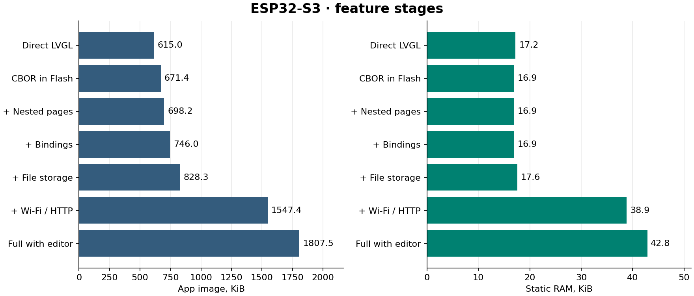
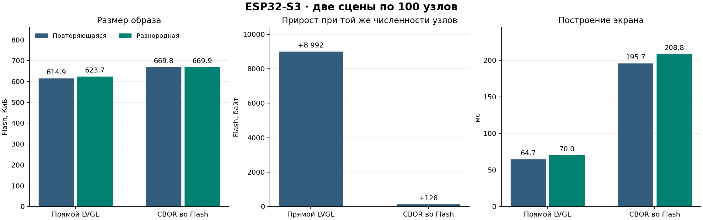

# Замеры на ESP32-S3 Touch LCD 7″

[English summary](results-s3.md)

## Выводы

- В исходном парном тесте построение и активация экрана из 100 узлов
  заняли 63–70 мс прямым LVGL и 196–210 мс через CBOR, примерно в три
  раза дольше. Это время загрузки экрана. Первый кадр после старта и
  последующие обновления измеряются отдельно.
- Повторное использование именованных стилей дало 2,75–6,63 мс
  экономии и 3,3–6 КиБ PSRAM после построения. Хеш кадра совпал.
- Штатная доверенная загрузка встроенного пакета убрала около 5 мс
  полной проверки. Проверка пакетов редактора сохраняется.
- Вырезание проверок длины команд и пофайловая оптимизация дали
  менее миллисекунды выигрыша на загрузке целиком при оптимизации
  по размеру. Текущие настройки оставляем. Возвращаться к оптимизации
  стоит при измеримой задержке на реальном экране.


12.11.2026. ESP-IDF 5.5.6, LVGL 9.6.0, 240 МГц, конфигурация оптимизации ESP-IDF `-Og`. Экран 800 × 480, RGB565,
DIRECT и два полноэкранных буфера в PSRAM. Четыре контрольных образа
собраны с байт-в-байт одинаковым sdkconfig. По три запуска на образ
для контрольных пар и по одному для ступеней.

| Профиль | Образ Flash, Б | Статическая RAM, Б | Первый кадр, мс | Свободно RAM / PSRAM после прогона, Б | Минимум свободной RAM / PSRAM, Б |
| --- | ---: | ---: | ---: | ---: | ---: |
| Плата и LVGL | 532 032 | 17 564 | 469,2 | 274 747 / 6 375 936 | 242 716 / 6 375 784 |
| Прямой LVGL, повторяющийся | 629 696 | 17 644 | 708,4 | 274 667 / 6 140 536 | 242 636 / 6 139 572 |
| CBOR, повторяющийся | 685 856 | 17 324 | 776,7 | 274 987 / 6 041 532 | 242 956 / 6 040 952 |
| Прямой LVGL, разнородный | 638 688 | 17 644 | 708,4 | 274 667 / 6 073 656 | 242 636 / 6 072 524 |
| CBOR, разнородный | 685 984 | 17 324 | 810,9 | 274 987 / 6 041 300 | 242 956 / 6 040 440 |
| Вложенные страницы | 717 280 | 17 644 | 879,2 | 274 667 / 5 848 904 | 242 636 / 5 675 264 |
| Биндинги и события | 974 144 | 21 924 | 947,6 | 270 131 / 5 562 704 | 238 100 / 5 386 740 |
| Схемы | 999 168 | 21 924 | 981,7 | 270 131 / 5 539 156 | 238 100 / 5 363 164 |
| История | 1 006 096 | 21 924 | 981,7 | 270 131 / 5 533 764 | 238 100 / 5 360 272 |
| CBOR из SPIFFS | 1 057 408 | 22 592 | 2533,2 | 266 355 / 5 425 480 | 235 036 / 5 252 004 |
| Wi-Fi | 1 603 984 | 43 764 | 1508,4 | 172 367 / 4 890 388 | 169 263 / 4 730 648 |
| NaWServer и HTTP API | 1 787 136 | 44 372 | 1508,4 | 155 127 / 4 590 080 | 154 907 / 4 551 876 |
| Встроенный редактор | 2 021 904 | 44 372 | 1508,4 | 155 123 / 4 355 824 | 154 903 / 4 317 648 |
| LVF2, RLE, WS и ввод | 2 049 456 | 48 460 | 1542,5 | 146 351 / 4 338 280 | 146 127 / 4 309 800 |

Первый кадр отсчитывается от таймера ESP-IDF. Свободная память в таблице —
медиана контрольной отметки. Минимум — наименьшее значение из измеренных
окон. RAM означает внутреннюю память с capability 8-bit. ESP-IDF может
учитывать ранее занятые системные резервы отдельно от статических секций.
Во Flash указана длина файла приложения, без загрузчика и FS.

## Итоговый прогон после оптимизаций

12.11.2026. Пересобраны 14 ступеней на ESP32-S3 7″, ESP-IDF 5.5.6,
LVGL 9.6.0. Контрольные пары 100 узлов имеют одинаковый sdkconfig и
собраны с `-Og`. По три старта на контрольный образ и по одному
на остальные ступени. Измерения записаны на этой же плате при
240 МГц и в DIRECT с двумя буферами RGB565.

| Профиль | Flash, Б | Статическая RAM, Б | Первый кадр, мс | Свободно RAM / PSRAM после прогона, Б | Минимум RAM / PSRAM, Б |
| --- | ---: | ---: | ---: | ---: | ---: |
| Плата и LVGL | 528 992 | 17 564 | 469,2 | 274 747 / 6 378 968 | 242 716 / 6 378 816 |
| Прямой LVGL, повторяющаяся | 629 808 | 17 652 | 708,4 | 274 659 / 6 140 504 | 242 628 / 6 139 540 |
| CBOR, повторяющаяся | 687 504 | 17 332 | 776,7 | 274 979 / 6 041 520 | 242 948 / 6 040 940 |
| Прямой LVGL, разнородная | 638 816 | 17 652 | 708,4 | 274 659 / 6 073 624 | 242 628 / 6 072 492 |
| CBOR, разнородная | 687 616 | 17 332 | 776,7 | 274 979 / 6 041 260 | 242 948 / 6 040 400 |
| Вложенные страницы | 714 928 | 17 324 | 879,2 | 274 987 / 5 851 840 | 242 956 / 5 678 172 |
| Биндинги и события | 763 904 | 17 324 | 879,2 | 274 731 / 5 779 584 | 242 700 / 5 603 612 |
| Схемы | 788 896 | 17 324 | 947,5 | 274 731 / 5 756 388 | 242 700 / 5 580 400 |
| История | 795 632 | 17 324 | 947,5 | 274 731 / 5 751 076 | 242 700 / 5 577 596 |
| CBOR из SPIFFS | 848 192 | 17 984 | 2669,9 | 270 963 / 5 642 112 | 239 644 / 5 468 684 |
| Wi-Fi | 1 401 456 | 39 180 | 1474,1 | 176 951 / 5 103 768 | 173 843 / 4 944 104 |
| NaWServer и HTTP API | 1 584 496 | 39 788 | 1474,2 | 159 659 / 4 803 324 | 159 475 / 4 765 020 |
| Встроенный редактор | 1 819 888 | 39 788 | 1474,2 | 159 695 / 4 568 712 | 159 475 / 4 530 464 |
| LVF2, RLE, WS и ввод | 1 850 912 | 43 876 | 2875,0 | 150 939 / 4 551 208 | 150 755 / 4 522 660 |

Прямой LVGL и CBOR дали одинаковые контрольные суммы первого кадра
в каждой паре. Для таблицы ступеней используется исходная выборка
пикселей стенда. Повторный замер проверяемой и доверенной загрузки
ниже использует все 384 000 пикселей.



### Оба режима загрузки в актуальном рантайме

Четыре образа `-Os` с одинаковым sdkconfig. Каждый образ содержит оба
пути, а тест вызывает один из них для конкретного пакета. Такты —
медиана трёх запусков. В столбце разбора также учтена обработка
пустого списка именованных стилей.

| Сцена | Режим | Разбор, такты | Объекты, такты | Layout, такты | Всего, такты | Всего, мс | Хеш кадра |
| --- | --- | ---: | ---: | ---: | ---: | ---: | --- |
| Повторяющаяся | Проверяемый | 1 504 286 | 18 588 120 | 8 013 810 | 32 223 045 | 134,26 | `aca92975` |
| Повторяющаяся | Доверенный | 142 328 | 18 492 219 | 8 027 742 | 30 834 453 | 128,48 | `aca92975` |
| Разнородная | Проверяемый | 1 502 891 | 19 861 635 | 9 203 528 | 34 791 198 | 144,96 | `7a504076` |
| Разнородная | Доверенный | 141 716 | 20 248 851 | 9 236 171 | 33 766 929 | 140,70 | `7a504076` |

Доверие передаётся из `ConstProjectSource` для каждого встроенного
экрана. Предпросмотр, WebSocket редактора и изменения из хранилища
используют проверяемую загрузку. Нативный тест подтвердил, что пакет
с дополнительным полем принимается из явно доверенного источника и
отклоняется в предпросмотре. Замена с тем же именем проверяется и
после повторного открытия файлового слоя. Признак доверия не
записывается в CBOR, а структура проекта проверяется при открытии.

### Проверка полной демки с редактором

Полная 7″ демка и встроенный редактор собраны. Проверяемая загрузка
из редактора и явно доверенный экран из прошивки проверены в одной
нативной сборке на общем ProjectService. На S3 отдельно пройдены
замеры обеих веток. В полной демке постоянный каталог подменял
встроенный экран, а контрольный образ с отключённым чтением каталога
не ответил по HTTP. Одновременная проверка обеих веток через
редактор на плате осталась незавершённой.

На полной ступени стенда получены каталог проекта, ресурсы редактора
и кадр по HTTP. Проверка WebSocket остановилась при подключении,
поэтому замер включает размер сборки с WS и не подтверждает передачу
кадра по WS в этом прогоне.

### Исторический эксперимент с предварительным обходом

13.11.2026. ESP32-S3 7″, 240 МГц, `-Os`. Одинаковый sdkconfig
и одна разнородная сцена из 100 узлов (5 322 Б CBOR). В обеих
сборках экран загружается как `TrustedEmbedded`. Единственный
переключатель в сравнении — `LVGL_CBOR_NAIVE_EMBEDDED`. Медиана
трёх запусков после watchdog-сброса на вариант.

| Режим | Разбор, такты | Создание объектов и стили, такты | Layout, такты | Всего, такты | Хеш полного первого кадра |
| --- | ---: | ---: | ---: | ---: | --- |
| Обычный доверенный | 142 952 | 19 991 217 | 9 025 050 | 33 280 530 | `7a504076` |
| Экспериментальный | 1 301 724 | 20 201 871 | 9 499 461 | 35 127 864 | `7a504076` |
| Разница | +1 158 772 | +210 654 | +474 411 | +1 847 334 | Совпадает |

Хеш всех 384 000 пикселей совпал во всех шести запусках. Разбор
занял дополнительно 4,83 мс, создание объектов со стилями — 0,88 мс.
Построение целиком замедлилось с 138,67 до 146,37 мс (+5,6%).
Экспериментальный обход проходит весь конверт, чтобы собрать
курсоры полей. На этой сцене он проиграл штатному поиску полей.
Размер образа вырос с 616 528 до 616 816 Б. Статическая RAM
одинаковая, 16 844 Б.

UART-журналы, хеши образов и исходные данные находятся в
`out/naive-reader`. После прогона на плате оставлен экспериментальный образ.

#### Раздельный замер обхода и проверок

Та же плата и та же сцена из 100 узлов. Совпадение `sdkconfig` и
байтов сгенерированной сцены проверено для всех четырёх образов.
По командам компилятора проверены `-Os` и независимые флаги двух
изменений. Везде включён `TrustedEmbedded`, поэтому снятая ранее
проверка сужения целых чисел одинакова во всех вариантах.
По три запуска после watchdog-сброса на образ, в таблице медианы.

| Вариант | Разбор, такты | Пропуск `root`, такты | Объекты и стили, такты | Layout, такты | Всего, такты | Образ, Б |
| --- | ---: | ---: | ---: | ---: | ---: | ---: |
| Штатный доверенный | 143 433 | — | 19 569 606 | 8 935 721 | 32 827 785 | 616 544 |
| Только обход конверта | 1 305 134 | 1 233 423 | 20 290 746 | 9 442 348 | 35 160 915 | 616 816 |
| Только снятие проверок | 143 001 | — | 20 113 359 | 9 402 872 | 33 787 236 | 616 640 |
| Оба изменения | 1 306 058 | 1 233 309 | 20 023 167 | 9 216 509 | 34 700 562 | 616 912 |

Полный первый кадр дал `7a504076` во всех 12 запусках. Столбец
«Пропуск `root`» входит в такты разбора. Новый обход сохраняет
курсор `root`, затем вызывает `cbor_value_advance()`, чтобы добраться
до следующего поля `bindings`. TinyCBOR рекурсивно обходит все
вложенные команды. На один этот вызов уходит около 1,233 млн тактов
(5,14 мс и 94,5% фазы разбора). Штатный поиск останавливается на
искомом ключе, а все нужные декодеру поля этой сцены находятся
перед `root` или на нём. Штатный путь сразу передаёт курсор
исполнителю. Таким образом, замедление воспроизводится одним
обходом, ещё до снятия проверок.

Снятие проверок само по себе оставило разбор около 143 тыс. тактов
и в этой сборке добавило около 544 тыс. тактов на создание объектов.
Это замер всей фазы, он не выделяет стоимость отдельной ветки.
Список именованных стилей в сцене пуст, поэтому замер снятия
проверок отражает пропуск предварительной проверки длины команд,
а проверка ключей именованного стиля здесь не выполняется.
Флаг эксперимента остаётся выключенным по умолчанию.

Это исторический эксперимент. В актуальном читателе предварительный
обход удалён. Сырые данные и команды компиляции старой серии
находятся в локальном `out/naive-split`.

### Три режима после удаления предварительного обхода root

ESP32-S3 7″, 240 МГц, `-Os`. Та же разнородная сцена из 100 узлов
и тот же пакет 5 322 Б во всех образах. Конфигурации совпадают
побайтово. По три запуска на вариант, в таблице медианы.

| Режим | Разбор, такты | Объекты и стили, такты | Layout, такты | Всего, такты | Образ, Б |
| --- | ---: | ---: | ---: | ---: | ---: |
| Полная проверка | 1 503 311 | 19 835 670 | 9 096 240 | 34 571 802 | 616 528 |
| Штатный доверенный | 142 958 | 20 042 406 | 9 031 907 | 33 325 479 | 616 528 |
| Облегчённый доверенный | 142 745 | 20 321 745 | 9 257 304 | 33 834 117 | 616 624 |

Первый кадр всех девяти запусков дал `7a504076`. Штатный поиск
вернул разбор доверенного варианта к 143 тыс. тактов. Полная
проверка добавила к разбору около 1,36 млн тактов (5,67 мс) и
к построению целиком около 1,25 млн тактов (5,19 мс) относительно
штатного доверенного пути. Облегчённый вариант отличался на
213 тактов разбора и занял на 2,12 мс больше на всём построении.
Экономия от отключения дополнительных проверок на этой сцене
не наблюдается. Сырые данные находятся в `out/validation-final`.

#### Полная 7″ демка с редактором

Отдельный прогон той же платы с полной S3 Style Lab под `-Os`,
NaWServer и ресурсами редактора. Для всех образов штатный проект
TPMS/GPS помещён в ROM, чтение слоя изменений временно отключено
без записи в файловую систему. Стартовый `shell` монтирует
`dashboard`. Такты фаз суммируются по этим двум экранам.
«Всего» — вызов `ProjectService::load_screen()`, включая вложение
и подготовку биндингов. Загрузка контейнера проекта, рисование
кадра и старт сети находятся за пределами замера. Три запуска
на вариант, в таблице медианы.

| Режим | Разбор, такты | Объекты и стили, такты | Layout, такты | Всего, такты | Образ, Б |
| --- | ---: | ---: | ---: | ---: | ---: |
| Полная проверка | 985 475 | 10 661 488 | 4 780 500 | 25 075 331 | 1 736 592 |
| Штатный доверенный | 278 495 | 10 144 958 | 4 870 191 | 23 856 398 | 1 736 576 |
| Облегчённый доверенный | 280 102 | 10 400 694 | 4 770 651 | 24 129 266 | 1 736 672 |

Полный первый кадр `443f67b0` совпал во всех девяти запусках.
Запуск HTTP подтверждён журналом каждого режима. Штатный
доверенный путь сократил загрузку на 5,08 мс относительно полной
проверки. Облегчённый занял на 1,14 мс больше штатного доверенного.
Четыре общих стиля проекта загружаются отдельно. Массивы локальных
именованных стилей пусты, поэтому ветка их проверки в этом сравнении
также не измерялась.

Для этой серии временно увеличен буфер имени файла каталога с
16 до 27 Б во всех образах. Под `-Os` без этой правки GCC останавливал
сборку с `-Werror=format-truncation`. Инструментирование и временная
правка не входят в исходники демки. Сырые данные — в
`out/validation-final/demo`.

### Проверки, вырезанные при компиляции, и оптимизация по скорости

ESP32-S3 7″, 240 МГц, та же разнородная сцена из 100 узлов и те же
5 322 Б CBOR. Во всех образах загрузка `TrustedEmbedded` и штатный
поиск полей. В каждой паре совпадают sdkconfig и байты сцены.
Оптимизация по размеру соответствует `-Os`, оптимизация по скорости
соответствует `-O2`. Фактические флаги проверены для нашего исполнителя,
TinyCBOR и LVGL. Для каждой прошивки снято по три запуска после
watchdog-сброса. В таблице медианы тактов.

| Вариант | Разбор, такты | Объекты и стили, такты | Layout, такты | Всего, такты | Всего, мс | Весь файл приложения, Б | Статическая RAM, Б | Хеш кадра |
| --- | ---: | ---: | ---: | ---: | ---: | ---: | ---: | --- |
| По размеру, с проверками | 143 162 | 19 829 301 | 8 997 096 | 33 160 296 | 138,17 | 616 528 | 16 844 | `7a504076` |
| По размеру, проверки вырезаны | 143 159 | 19 723 176 | 8 922 848 | 32 962 695 | 137,34 | 616 416 | 16 844 | `7a504076` |
| По скорости, с проверками | 111 970 | 19 888 319 | 9 170 780 | 32 297 422 | 134,57 | 719 360 | 17 092 | `7a504076` |
| По скорости, проверки вырезаны | 110 813 | 20 180 849 | 9 527 514 | 32 985 281 | 137,44 | 718 848 | 17 092 | `7a504076` |

В образах с вырезанными проверками препроцессор убирает чтение
длины массива команды, сравнение числа полей и проверку набора
ключей определения локального стиля. В цикле отсутствует выбор
режима проверки этих условий. Границы чтения и конец массива
проверяются. В этой сцене локальных именованных стилей нет,
поэтому замер отражает снятие проверок длины команд.

- При оптимизации по размеру убрали 112 Б Flash и 106 125 тактов создания объектов
  (0,44 мс). Весь экран строился на 0,82 мс быстрее. Разбор практически
  совпал.
- При оптимизации по скорости убрали 512 Б Flash, но создание объектов заняло на
  292 530 тактов больше (1,22 мс). Весь экран строился на 2,87 мс дольше.
  Это разница двух скомпонованных образов, а не стоимость отдельной
  инструкции. Она не доказывает, что сама проверка ускоряет исполнение.
- Быстрее всех построил экран образ с оптимизацией по скорости
  и включёнными проверками. Он выиграл 3,60 мс (2,6%) у образа
  с оптимизацией по размеру и теми же проверками, занял на 102 832 Б
  больше Flash и на 248 Б больше статической RAM. Разбор быстрее
  на 31 192 такта, создание объектов в этой паре практически совпало.

Хеш всех 384 000 пикселей совпал в 12 запусках. На плате остался
последний образ с оптимизацией по скорости и вырезанными проверками.

#### Сколько занимает наш код

Весь файл приложения — размер `firmware.bin` вместе с LVGL,
TinyCBOR, ESP-IDF, кодом стенда и ресурсами. В него входят
5 322 Б CBOR сцены. Загрузчик, таблица разделов и файловая
система в файл приложения не входят.

Ниже вклад архивов в секции `.flash.text` и `.flash.rodata`
по карте линковки. Столбец NaCBORUIforLVGL показывает наш код
и его константы. Сцена и ресурсы принадлежат коду стенда.

| Режим | NaCBORUIforLVGL, Б | TinyCBOR, Б | LVGL, Б |
| --- | ---: | ---: | ---: |
| По размеру, с проверками¹ | 20 536 | 3 324 | 266 988 |
| По размеру, проверки вырезаны | 20 422 | 3 324 | 266 988 |
| По скорости, с проверками | 29 735 | 3 886 | 347 989 |
| По скорости, проверки вырезаны | 29 221 | 3 886 | 347 989 |

При включённых проверках переход на оптимизацию по скорости
увеличил весь файл приложения на 102 832 Б. В разбивке по картам
на NaCBORUIforLVGL приходится +9 199 Б, на LVGL +81 001 Б,
на TinyCBOR +562 Б. Вырезание проверок уменьшило вклад
NaCBORUIforLVGL на 114 Б при оптимизации по размеру и на 514 Б
при оптимизации по скорости. Статическая память нашего архива
составляет 4 Б во всех четырёх картах.

¹ Карта режима «по размеру, с проверками» получена повторной
линковкой с теми же командами компилятора. Повторный файл
приложения оказался на 400 Б больше прошитого, поэтому его
разбивка по архивам относится к пересборке. Для трёх других
карт хеш пересобранного файла совпал с прошитым.

Для воспроизведения задайте `NACBOR_BENCH_PROFILE_OVERRIDE=4` и
`NACBOR_BENCH_TRUSTED_CBOR=1`. Соберите `phases-os` и `phases-o2`
с `NACBOR_BENCH_NO_COMMAND_CHECKS=0` и `1`. Профиль
`phases-o2` выбирает `CONFIG_COMPILER_OPTIMIZATION_PERF=y`.
`NACBOR_BENCH_NAIVE_EMBEDDED` в этой серии выключен.
Сырые данные, конфигурации и команды компилятора находятся в
`out/compiled-checks`.

#### Оптимизация по скорости только двух файлов

На той же встроенной сцене с проверками только `screen_decode.cpp`
и `widget_dispatch.cpp` собраны с оптимизацией по скорости. Остальная
прошивка собрана с оптимизацией по размеру. Это подтверждено по командам
компиляции. По трём запускам медианы составили 144 429 тактов разбора,
19 419 474 такта создания объектов и применения стилей и 32 989 962 такта
(137,46 мс) на построение целиком. Хеш кадра `7a504076` совпал.
Относительно исходного образа с оптимизацией по размеру выигрыш составил
1,71 мс на создании объектов и 0,71 мс (0,5%) на всём построении.

Файл приложения вырос на 4 752 Б до 621 280 Б. Наш код и константы
занимают 25 814 Б по карте линковки, это +5 278 Б относительно карты
повторной сборки с оптимизацией по размеру. Вклады LVGL и TinyCBOR
совпали. Пофайловый режим использовался только в экспериментальной
сборке. Сырые данные находятся в `out/compiled-checks/selective`.
На плате оставлен этот экспериментальный образ.

### Какие оптимизации вошли

- Именованные стили в стенде получаются на этапе подготовки разметки
  и используют существующие определения и ссылки. [Сравнение стилей](#переиспользование-именованных-стилей).
- Диагностические строки заполняются при ошибке. Составные аргументы
  отдают дочитанный курсор, а проверяемый конверт обходится один раз.
  [Такты по стадиям](#один-проход-аргументов-и-проверка-конверта).
- Биндинги и JSON используют общий выбор форматтера. Для ESP-IDF по
  умолчанию используется `snprintf`. [Замеры форматтеров](number-format-s3.md).
- В минимальных профилях вложенность, биндинги, ProjectService и
  обратная передача кадра добавляются отдельно. Буферы панели
  учитываются отдельно от статической RAM.

Сырые UART-замеры, карты линковки, конфигурации, проверка хешей образов и
график воспроизводятся из локального `out/final-matrix`.
Для графика используется `python examples/memory_bench/plot_results.py matrix`.

## Сравнение ровно 100 узлов

| Сцена | Flash прямой / CBOR, Б | Построение прямое / CBOR, мс | Разметка CBOR, Б | Хеш первого кадра |
| --- | ---: | ---: | ---: | --- |
| Повторяющаяся | 629 696 / 685 856 | 64,7 / 195,7 | 5 189 | `65810886` |
| Разнородная | 638 688 / 685 984 | 70,0 / 208,8 | 5 322 | `10bb739a` |

Портрет хранится как RGB565 в образе приложения. Для обеих пар совпали количество
объектов и контрольная сумма выборки первого кадра. Проба framebuffer
дала 54 цвета в области портрета и 5 цветов в первом кадре GIF.
Переход к разнородной сцене добавил 8 992 Б прямому образу и 128 Б CBOR-образу.
Сам минимальный рантайм с TinyCBOR увеличил размер обеих пар. Его разница
с прямым кодом составляет 56 160 Б на повторяющейся сцене и 47 296 Б на разнородной.



На этих двух сценах по 100 узлов прямой LVGL занимает меньше Flash и
быстрее строит экран. Повторяющаяся сцена особенно выгодна прямому коду:
один цикл переиспользует набор вызовов LVGL. На разнородной сцене прямой
образ вырос на 8 992 Б, а CBOR-образ на 128 Б. Разрыв уменьшился на 8 864 Б.
В CBOR изменения раскладки в основном увеличили данные. Один и тот же
рантайм обработал обе сцены, а сами документы заняли 5 189 и 5 322 Б.
При фиксированной раскладке и жёстком бюджете эти замеры говорят в пользу
прямого кода. Если одну прошивку нужно использовать с разными раскладками,
56 160 или 47 296 Б — измеренная цена рантайма с TinyCBOR в этих сборках.
Из двух сцен одинаковой длины нельзя вывести порог окупаемости по числу узлов.

По символам ELF функция `build_direct()` занимает 664 Б для повторяющейся
сцены и 8 312 Б для разнородной. Повторения свернул в циклы сам генератор
прямого кода. Для разнородной сцены он выписал вызовы отдельно, и после
компиляции тело функции осталось больше на 7 648 Б. Значения аргументов,
строковые литералы и выбранные реализации LVGL также влияют на размер.

У двух CBOR-образов одинаковый размер секции `.flash.text` — 430 802 Б.
Почти весь прирост между ними приходится на `.flash.rodata` — 128 Б.
В повторяющейся паре CBOR-образ добавляет 45 664 Б в `.flash.text` и
10 580 Б в `.flash.rodata`, в том числе 5 189 Б самой разметки. Остальное
приходится на код и константы, которые нужны декодеру, проверкам,
диспетчеризации, стилям и созданию дерева через общий рантайм. Обе версии
в конечном счёте вызывают функции LVGL. CBOR заменяет места вызова в коде
описанием аргументов, а на МК добавляет разбор этого описания.

### Аппаратный счётчик тактов

По три запуска на профиль. Замер охватывает `build_direct()` или
`ScreenRuntime::load()` с момента входа до возврата. Обе функции
активируют экран, а вывод первого кадра и декодирование GIF следуют
позже. `app_main` закреплён на CPU0. Приоритет задачи на время замера
повышен на два уровня, системные прерывания работают. Счётчик показывает
прошедшие такты ядра, включая прерывания. Частота фиксирована на 240 МГц.

| Сцена | Прямой LVGL, такты | CBOR, такты | Прямой / CBOR, мс | Отношение |
| --- | ---: | ---: | ---: | ---: |
| Повторяющаяся | 15 208 082 | 46 995 917 | 63,37 / 195,82 | 3,09× |
| Разнородная | 16 775 816 | 50 346 530 | 69,90 / 209,78 | 3,00× |

Указаны медианы. Размах между запусками — до 0,14% в каждой серии.
Во всех 12 запусках стенд подтвердил 100 узлов и совпадение хеша
первого кадра в соответствующей паре. График выше использует исходные
временные отметки, таблица тактов измеряет более узкий интервал.

## Загрузка CBOR после переноса диагностики на путь ошибки

12.11.2026. Две исходные сцены по 100 узлов, по три холодных запуска на
сочетание сцены и оптимизации. CPU0, 240 МГц, приоритет +2, прерывания
включены. Проверены флаги компиляции рантайма, TinyCBOR и LVGL.
Контрольные суммы первого кадра совпали с исходным экспериментом
во всех 12 запусках.

- **Разбор** охватывает предварительную проверку дерева CBOR и чтение
  конверта. В обоих пакетах список именованных определений пуст.
- **Объекты и стили** охватывают чтение команд и их аргументов в курсоре,
  вызовы LVGL, создание узлов, встроенных стилей и подключение стилей.
- **Layout** охватывает вызов `lv_obj_update_layout()`.
- **Остальное** включает подготовку экземпляра, активацию и переключение
  экрана. Первый рендер, декодирование GIF и запуск панели измеряются отдельно.

| Сцена | Флаг | Разбор, такты | Объекты и стили, такты | Layout, такты | Остальное, такты | Всего, такты | Всего, мс |
| --- | --- | ---: | ---: | ---: | ---: | ---: | ---: | ---: |
| Повторяющаяся | `-Og` | 3 253 893 | 25 063 645 | 10 357 188 | 4 818 084 | 43 492 789 | 181,22 |
| Повторяющаяся | `-Os` | 2 866 932 | 18 702 887 | 7 937 155 | 4 093 908 | 33 600 931 | 140,00 |
| Разнородная | `-Og` | 3 251 604 | 27 160 165 | 11 733 966 | 4 864 455 | 47 010 190 | 195,88 |
| Разнородная | `-Os` | 2 864 136 | 19 992 719 | 9 025 382 | 4 128 967 | 36 013 421 | 150,06 |

Колонки показывают медианы независимо. В проверенных сборках
`-Os` уменьшил время и размер приложения:

| Сцена | Flash `-Og` / `-Os`, Б | Экономия Flash | Экономия времени загрузки |
| --- | ---: | ---: | ---: |
| Повторяющаяся | 686 560 / 615 184 | 71 376 Б | 22,7% |
| Разнородная | 686 688 / 615 328 | 71 360 Б | 23,4% |

Статическая RAM снизилась с 17 340 до
16 836 Б в обеих сценах.
Флаг изменён в профиле замеров.

Сравнение с предыдущим замером `-Og` на том же sdkconfig и с теми же
хешами кадров:

- Повторяющаяся — 195,82 → 181,22 мс, минус 7,5%.
- Разнородная — 209,78 → 195,88 мс, минус 6,6%.

Это сравнение полной загрузки с прошлой серией. В новой сборке добавлены
три замера на границах фаз. Дизассемблирование подтвердило отсутствие
`snprintf` в цикле команд. `ScreenReply` сохраняет ID ближайшего
именованного узла и исходный opcode ошибки. Проверены отказ дочернего
метода, несуществующий тип, ошибка стиля и сохранение активного экрана.

## Переиспользование именованных стилей

12.11.2026. Сравнение четырёх образов `-Os` с одинаковым `sdkconfig`,
по три запуска на образ. Генератор стенда выносит только повторяющиеся
блоки MAIN/DEFAULT в определения `screen:sN`. Уникальные блоки остаются
встроенными. Если раскрыть ссылки в CBOR, программа команд и конверт
совпадают с исходным пакетом байт в байт. Селектор, порядок и аргументы
сохранены. Изменение применяется к сценам стенда по флагу сборки.

| Сцена | Встроенных блоков до | Определений + уникальных встроенных после | Ссылок |
| --- | ---: | ---: | ---: |
| Повторяющаяся | 100 | 11 + 12 = 23 | 88 |
| Разнородная | 100 | 6 + 52 = 58 | 48 |

Сначала `decode_screen` создаёт каждое именованное определение в
области экрана. Ссылка на узле передаёт существующий `lv_style_t` в
`lv_obj_add_style`, поэтому свойства для этого узла заново не применяются.
У узлов остаётся своё подключение стиля с селектором и ссылка на владельца.

| Сцена | Стили | Разбор, такты | Именованные стили, такты | Объекты, такты | Layout, такты | Всего, такты | Всего, мс |
| --- | --- | ---: | ---: | ---: | ---: | ---: | ---: |
| Повторяющаяся | Встроенные | 2 867 334 | 327 | 18 689 030 | 8 152 454 | 33 813 787 | 140,89 |
| Повторяющаяся | Именованные | 2 491 574 | 450 559 | 17 589 266 | 8 188 831 | 32 222 511 | 134,26 |
| Разнородная | Встроенные | 2 863 512 | 333 | 20 684 984 | 9 511 062 | 37 196 361 | 154,98 |
| Разнородная | Именованные | 2 705 422 | 241 884 | 20 227 679 | 9 515 038 | 36 534 402 | 152,23 |

Разбор показан за вычетом вложенного таймера чтения и создания именованных
стилей. При пустом списке этот таймер учитывает проверку массива.
Создание объектов включает чтение команд и аргументов, применение
оставшихся встроенных стилей и разрешение ссылок. Полная загрузка включает
все этапы до возврата `ScreenRuntime::load()`. Первый рендер измеряется
отдельно. В каждой колонке медиана трёх запусков.

| Сцена | Стили | CBOR, Б | Flash, Б | Статика RAM, Б | Свободно RAM / PSRAM после построения, Б | Минимум свободной RAM / PSRAM в окне построения, Б |
| --- | --- | ---: | ---: | ---: | ---: | ---: |
| Повторяющаяся | Встроенные | 5 189 | 615 504 | 16 844 | 284 171 / 6 211 436 | 284 171 / 6 210 608 |
| Повторяющаяся | Именованные | 5 067 | 615 376 | 16 844 | 284 171 / 6 217 564 | 284 171 / 6 216 744 |
| Разнородная | Встроенные | 5 322 | 615 632 | 16 844 | 284 171 / 6 211 152 | 284 171 / 6 210 176 |
| Разнородная | Именованные | 5 234 | 615 536 | 16 844 | 284 171 / 6 214 532 | 284 171 / 6 213 564 |

- Повторяющаяся — 140,89 → 134,26 мс (4,7% экономии времени), полный хеш кадра `aca92975`.
- Разнородная — 154,98 → 152,23 мс (1,8% экономии времени), полный хеш кадра `7a504076`.

Хеш рассчитан по всем 384 000 пикселям первого RGB565-кадра с GIF,
остановленной на первом кадре. Контрольные суммы совпали в каждой паре
во всех 12 запусках. Во всех образах построено по 100 узлов.

Сборка из каталога стенда:

```powershell
$env:NACBOR_BENCH_NAMED_STYLES='0'
.\build.ps1 -Profiles cbor-repeat,cbor-mixed -CacheEnvironment phases-os -OutputRoot out/named-styles/inline
$env:NACBOR_BENCH_NAMED_STYLES='1'
.\build.ps1 -Profiles cbor-repeat,cbor-mixed -CacheEnvironment phases-os -OutputRoot out/named-styles/named
Remove-Item Env:NACBOR_BENCH_NAMED_STYLES
```

Для каждого каталога применяются описанные выше `measure.py` и `report.py`.
`report.py` сохраняет вложенный счётчик `named_styles` и исходный
`parse`, который включает чтение и создание именованных стилей.

## Разбор циклов перед объединением проходов

1. **Стилевые выделения и вызовы LVGL.** В каждом пакете 100 встроенных
   стилевых блоков. В повторяющемся только 23 уникальных по селектору и
   последовательности методов, в разнородном — 58. Всего применяется 387
   и 395 стилевых свойств соответственно. Сейчас `own_style` создаёт
   отдельный владеющий объект на блок. `lv_style_set_prop()` в LVGL
   ищет существующее свойство, а при новом расширяет массив через
   `lv_realloc()` и сдвигает свойства. Результаты переиспользования совпадающих блоков приведены выше.
2. **Повторное чтение аргументов.** Исполнитель стиля читает карту через
   вложенный курсор. Затем внешний `cbor_value_advance()` снова проходит
   её целиком. Составные аргументы стандартных виджетов также читаются
   внутренним курсором, после чего пропускаются внешним. Передача наружу
   продвинутого курсора уберёт повторный обход без смены формата.
3. **Конверт.** `bounded_cbor` и `keys` оба проходят дерево `root`.
   В этих двух пакетах остальные вызовы `field` останавливаются до
   входа в дерево. Отсутствующее поле или поле после `root` заставит
   поиск пройти его снова. Курсоры полей можно собирать при проверке
   конверта, сохраняя лимиты, проверку дубликатов и хвоста пакета.
4. **Layout и диспетчеризация.** `lv_obj_update_layout()` проходит дерево
   и может повторить проход, если обработка снова пометила раскладку
   грязной. Здесь это отдельная заметная фаза. `switch` выбирает
   обработчики внутри более дорогой фазы создания, а стилевые функции
   уже выбираются по таблицам. Выделенный замер диспетчеризации нужен
   перед экспериментом с GNU `computed goto`.

### Повторить замеры фаз

Из каталога `examples/memory_bench` в PowerShell:

```powershell
.\build.ps1 -Profiles cbor-repeat,cbor-mixed -CacheEnvironment phases-og -OutputRoot out/scene-phases/og
.\build.ps1 -Profiles cbor-repeat,cbor-mixed -CacheEnvironment phases-os -OutputRoot out/scene-phases/os
```

Для каждого каталога результатов:

```text
python measure.py --output-dir OUTPUT_DIR --port PORT --usb-serial DEVICE_SERIAL --esptool ESPTOOL --restore-image PATH_TO_CURRENT_APP cbor-repeat cbor-mixed
python report.py --output-dir OUTPUT_DIR cbor-repeat cbor-mixed
```

Опция `--restore-image` проверяет текущий образ перед первой записью,
а после замера восстанавливает его и сверяет хеш. Сводка с диапазонами
сохраняется в `summary.json` рядом с необработанными замерами.

## Один проход аргументов и проверка конверта

12.11.2026. Разнородная сцена из 100 узлов, встроенные стили,
5322 Б CBOR, `-Os`, один и тот же sdkconfig, три старта на образ.
Варианты накопительные. Для первого использованы сохранённые
замеры исходного образа из предыдущей серии. Хеш всех пикселей
RGB565 `7a504076` совпал в 12 запусках. Контракты Screen ABI v3
и Style ABI v2 совпадают с исходными.

| Вариант | Разбор, такты | Объекты и стили, такты | Layout, такты | Всего, такты | Всего, мс | Выигрыш к предыдущему, мс |
| --- | ---: | ---: | ---: | ---: | ---: | ---: |
| Исходный | 2 863 845 | 20 684 984 | 9 511 062 | 37 196 361 | 154,98 | — |
| Курсор аргументов | 2 865 671 | 20 063 100 | 9 130 865 | 36 215 454 | 150,90 | 4,09 |
| Один обход конверта | 1 503 925 | 20 210 637 | 9 261 044 | 35 113 005 | 146,30 | 4,59 |
| Доверенный пакет | 143 207 | 20 113 350 | 9 467 337 | 33 831 690 | 140,97 | 5,34 |

Все колонки — медианы. Разбор включает конверт, стадия объектов —
потребление аргументов команд и применение стилей. Всего — такты
до возврата из загрузки экрана с активацией.

| Вариант | Flash, Б | Статическая RAM, Б | Локальный кадр стека `decode_screen`, Б |
| --- | ---: | ---: | ---: |
| Исходный | 615 632 | 16 844 | 528 |
| Курсор аргументов | 615 872 | 16 844 | 528 |
| Один обход конверта | 616 048 | 16 844 | 752 |
| Доверенный пакет | 615 472 | 16 844 | 432 |

Стек указан по инструкции `entry` в ELF. В проверяемом режиме
на стеке сохраняются позиции верхнеуровневых полей. Полный пик
стека задачи включает вызванные функции и в таблице не измерялся.

1. Исполнитель встроенного стиля заканчивает карту через
   `cbor_value_leave_container`. Тот же принцип применяется к
   составным аргументам стандартных виджетов, точкам линий и
   массивам треков Grid. Результаты чтения передаются наружу через
   изменённый курсор.
2. Проверяемый режим за один обход собирает поля и проверяет
   границы пакета, глубину, теги, имена и повторы верхнеуровневых
   ключей. Нативный тест проверяет дубликат, неизвестное поле,
   лишние байты, превышение глубины и тег с сохранением старого экрана.
3. В этой серии доверенный вариант был отдельным образом со снятым
   предварительным обходом. В текущем рантайме этот выбор перенесён
   на вызов загрузки. Обязательные поля, ABI, аргументы, размеры,
   ресурсы и лимиты проверяются в обоих режимах.

В стенде доверенный вариант включается переменной
`NACBOR_BENCH_TRUSTED_CBOR=1` при сборке `cbor-mixed` в
`phases-os`. Исходный, промежуточный и финальные образы, отчёты
UART и sdkconfig сохранены в локальных `out/named-styles` и
`out/cursor-validation`. Совпадение образа при восстановлении платы
проверено esptool.

## Где меняется память

- Буферы и инициализация панели забрали 1 536 584 Б PSRAM на контрольном образе.
- Запуск GIF уменьшил свободную PSRAM на 100 388 Б в прямой повторяющейся сцене.
- Вложенность. Открытие второй страницы при удержании первой заняло 172 352 Б PSRAM. После закрытия третьей страницы с политикой release вернулось 172 432 Б.
- Биндинги и события. Прирост образа 256 864 Б и статической RAM 4 280 Б. По карте линковки код из файлов локалей и facets в libstdc++ вырос с 870 до 104 997 Б. Это вклад связанных файлов, а не прогноз экономии от замены одного вызова.
- SPIFFS. Первая запись подготовленного файла перед чтением заняла 1100,8 мс. Wi-Fi, HTTP и редактор использовали уже созданный файл. Полный профиль добавляет кнопки схем и готовит свою версию файла при первом запуске.
- Wi-Fi. Один вызов esp_wifi_init уменьшил свободную внутреннюю RAM на 29 076 Б. Время до IP и запуска сервера вынесено в отдельные отметки.
- XIP для инструкций и rodata включён. Образы с разным кодом могут начинать с разным запасом PSRAM ещё до создания объектов. Эту разницу видно на отметке entry.

## Полная сборка

Первый кадр — 1542,5 мс. IP получен через 6282,6 мс, NaWServer начал принимать соединения через 6307,7 мс.
Образ занимает 2001,4 КиБ Flash, статическая RAM — 47,3 КиБ. Из прежних 91,9 КиБ часть относилась к очередям старой демки. В этом стенде некоторые обработчики живут в заранее зарезервированном стеке, поэтому для сравнения полного расхода надо смотреть и свободную память.

## Секции карты линковки

| Секция, Б | Прямой LVGL | Минимальный CBOR | Страницы | Биндинги | Полный |
| --- | ---: | ---: | ---: | ---: | ---: |
| .flash.text | 385 138 | 430 802 | 446 278 | 682 506 | 1 351 590 |
| .flash.rodata | 157 996 | 168 576 | 184 520 | 204 600 | 569 876 |
| .iram0.text | 71 335 | 71 255 | 71 255 | 71 555 | 104 231 |
| .iram0.vectors | 1 028 | 1 028 | 1 028 | 1 028 | 1 028 |
| .dram0.data | 13 788 | 13 788 | 13 788 | 14 044 | 22 332 |
| .dram0.bss | 3 856 | 3 536 | 3 856 | 7 880 | 26 128 |

Два минимальных профиля в таблице используют повторяющуюся сцену.

## Проверка веба

На работающей плате прочитаны проект и каталог, загружен редактор,
декодирован кадр 800 × 480 по HTTP и по WS. Через API ввода
переключены обе страницы, проверены Dark и Cream по цвету framebuffer,
подтверждена анимация GIF.
Разовый полный кадр: HTTP 1 322 мс, WS 1 647 мс. По WS передано 145 358 Б полезных данных кадра.

В одном повторе чтение BMP прервалось из-за неполного HTTP-тела.
Повторное чтение и проверки LVF2 по HTTP и WS завершились успешно.
Замер кадра разовый и не сравнивает производительность транспортов.

Детальные контрольные точки, минимум и разброс по запускам, карты линковки
и UART-трассы лежат в игнорируемом out. Порядок воспроизведения
описан в [README стенда](README.md).
